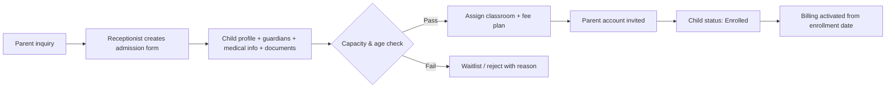
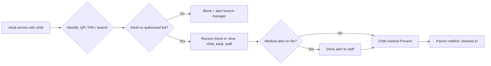
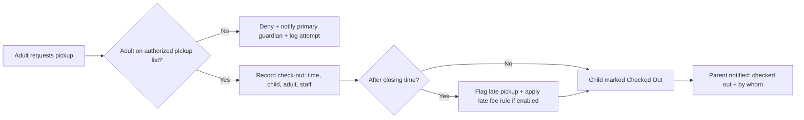
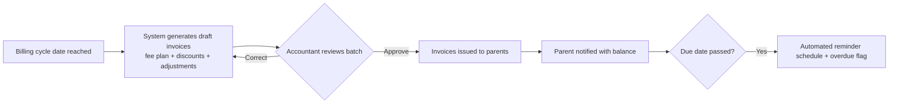
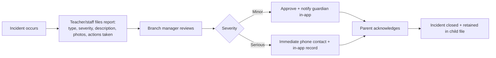

# KinderFlow — Business Requirements Document (BRD)

| Field | Value |
|-------|-------|
| Document | Business Requirements Document |
| Product | KinderFlow — Multi-Tenant Nursery & Daycare Management SaaS |
| Version | 1.1 |
| Date | 2026-07-18 |
| Author | Product & Business Analysis |
| Status | **Approved — Ready for Architecture Phase** |
| Related | `docs/00_Product_Discovery/*`, `docs/Decisions/DR-001_Founder_Decisions.md` |

### Revision History

| Version | Date | Changes |
|---------|------|---------|
| 1.0 | 2026-07-18 | Initial draft; Q1–Q8 open |
| 1.1 | 2026-07-18 | Founder decisions D1–D8 applied: Egypt launch, capacity-based 3-plan pricing, PWA-first, sales-assisted onboarding, configurable late fees, plan-based storage quotas, AR/EN launch languages, 5-year retention default. Q1–Q8 closed; §7, §10, §11, §12, §13 updated; status set to Ready for Architecture |

---

## 1. Executive Summary

### 1.1 Purpose

KinderFlow is a multi-tenant B2B SaaS platform that digitizes the full operation of nurseries and daycare centers: enrollment, attendance, daily activity tracking, billing, staff management, and parent communication — with an AI layer that removes repetitive administrative work.

### 1.2 Business Value

| Value Driver | Mechanism |
|--------------|-----------|
| Revenue recovery | Systematic invoicing, payment tracking, and automated reminders eliminate untracked/forgotten fees |
| Time savings | AI-drafted daily reports and digital check-in replace 30–60 min/day of manual work per teacher |
| Parent retention & referral | Daily activity feed, instant check-in/out notifications, transparent billing |
| Compliance & safety | Authorized-pickup enforcement, ratio monitoring, incident logs, auditable child records |
| Owner visibility | Real-time occupancy, revenue, and attendance dashboards across branches |

### 1.3 Expected Users

| User Type | Surface | Est. share of DAU |
|-----------|---------|-------------------|
| Parents/Guardians | Parent app (PWA/mobile) | ~70% |
| Teachers | Teacher app (PWA/mobile) | ~20% |
| Admins (owner, branch manager, receptionist, accountant) | Web app | ~9% |
| Platform operators (KinderFlow staff) | Internal admin panel | ~1% |

### 1.4 Business Goals

Close the daily engagement loop (teacher logs → parent sees → owner bills) as the retention engine; win localization-underserved markets before US/EU incumbents; monetize via capacity-based subscription per tenant.

### 1.5 Market Strategy (D1)

**Launch market: Egypt.** Expansion sequence: Saudi Arabia → UAE → wider GCC. Product ships Arabic (RTL) + English at launch (D7); localization (language, payment culture, compliance) is a first-class architectural requirement, not a retrofit.

---

## 2. Business Objectives

All targets measured per tenant, 90 days post-onboarding, unless noted.

| # | Objective | Metric | Target |
|---|-----------|--------|--------|
| O1 | Reduce administrative workload | Teacher time on reporting/day | −50% (from ~45 min to ≤20 min) |
| O2 | Improve parent communication | Parents opening daily report same-day | ≥70% |
| O3 | Reduce billing errors | Invoices requiring manual correction | <2% |
| O4 | Reduce outstanding payments | Overdue receivables >30 days | −40% vs. pre-KinderFlow baseline |
| O5 | Improve attendance accuracy | Digital check-in coverage of actual attendance | ≥98% |
| O6 | Increase occupancy visibility | Owner dashboard shows live occupancy per branch | Real-time (<5 min lag) |
| O7 | Platform commercial goal | Tenant logo churn (annual) | <10% |
| O8 | Onboarding efficiency | Tenant setup → first invoice issued | ≤7 days |

---

## 3. Business Scope

### 3.1 In Scope (MVP — per approved Feature Map)

| Area | Included |
|------|----------|
| Platform core | Multi-tenancy (org → branch → classroom), authentication, RBAC, audit logging |
| Children & families | Child profiles, guardians, medical info & alerts, documents, authorized pickup list |
| Attendance | QR/PIN check-in & check-out, pickup authorization check, late pickup flagging |
| Daily activities | Meals, naps, diaper/toilet, mood, photos; AI-drafted, teacher-approved daily report to parent feed |
| Billing | Fee plans, discounts, invoice generation, manual payment recording, reminders, outstanding balance reports |
| Communication | Announcements (branch/classroom), direct admin↔parent & teacher↔parent messaging, incident reports, quiet hours |
| Staff | Staff profiles, role assignment (no scheduling in MVP) |
| Platform admin | Tenant provisioning, subscription status, feature flags (minimal) |

### 3.2 Out of Scope (MVP)

| Area | Deferred to |
|------|-------------|
| Online payment gateway integration | Phase 2 (blocked on launch-market decision) |
| Enrollment pipeline (inquiry → tour → application → contract) | Phase 2 (MVP uses simple admission form) |
| Staff scheduling, leave management, payroll | Phase 2+ |
| Curriculum, milestones, assessments | Phase 2 |
| AI forecasting & billing anomaly detection | Phase 2 (MVP ships AI report drafting only) |
| Native mobile apps (if PWA-first is approved) | Phase 2/3 |
| Accounting integrations, government subsidy claims, transport tracking, CCTV | Not planned for MVP horizon |

---

## 4. Stakeholders

| Stakeholder | Responsibilities | Goals | Pain Points | Success Criteria |
|-------------|------------------|-------|-------------|------------------|
| Nursery Owner | Business strategy, P&L, compliance, final authority on fees & staff | Profitability, occupancy, reputation, control across branches | No real-time financial view; revenue leakage; dependence on key staff | Answers "how is my business today?" in 10 seconds; overdue receivables down 40% |
| Branch Manager | Daily operations of one branch: staffing, parents, incidents, ratios | Smooth operations, satisfied parents, compliant classrooms | Firefighting via phone/WhatsApp; paper records; ratio surprises | Live branch dashboard; incidents documented and closed in-app |
| Teacher | Classroom care, activity logging, daily reports, parent updates | Time with children, not paperwork; clear boundaries | 30–60 min/day of reporting; parent messages on personal phone at night | Logs any event in ≤5 taps; AI drafts report; quiet hours enforced |
| Receptionist | Front-desk check-in/out, visitor control, admission forms, parent onboarding | Fast, safe handover at the gate | Manual registers; verifying pickup identity from memory | Check-in ≤10 s/child; system blocks unauthorized pickup |
| Accountant | Fee plans, invoicing, payment recording, reconciliation, financial reports | Accurate books, zero missed invoices | Excel reconciliation; sibling discounts computed by hand | Monthly invoice run in <10 min; <2% invoice corrections |
| Parent | Provides child data, pays fees, authorizes pickups | Child safety, daily visibility, easy payment | Information vacuum; WhatsApp chaos; surprise invoices | Same-day report with photos; instant check-in/out notifications; clear balance |
| System Administrator (KinderFlow) | Tenant lifecycle, subscriptions, support, platform health | Reliable platform, fast support resolution, tenant data isolation | Cross-tenant support without touching tenant data improperly | Break-glass access is audited; tenant provisioning fully self-service |

---

## 5. User Personas

### 5.1 Mona — Nursery Owner (2 branches, 140 children)

**Background:** Founded her nursery 8 years ago; expanded to a second branch. Business-savvy, not technical.
**Goals:** Grow to 4 branches; know occupancy and cash position daily; reduce dependence on herself.
**Frustrations:** Each branch reports differently; fee collection tracked in two Excel files; finds out about incidents days later.
**Technical skills:** Smartphone-fluent; uses WhatsApp and basic Excel.
**Daily workflow:** Morning branch calls → reviews cash notes → afternoon parent escalations → evening reconciliation attempts.

### 5.2 Sara — Teacher (toddler room, 14 children)

**Background:** 5 years' experience; passionate about child development.
**Goals:** Finish documentation during class downtime; keep parents happy without giving out her number.
**Frustrations:** Paper meal/nap sheets copied into WhatsApp messages nightly; blamed when parents feel uninformed.
**Technical skills:** Heavy mobile user; avoids desktop software.
**Daily workflow:** 7:30 setup → receives children → logs meals/naps/activities on paper → 16:00 writes 14 individual parent updates → handover.

### 5.3 Ahmed — Accountant (part-time, serves both branches)

**Background:** External accountant handling 3 small businesses.
**Goals:** Standardized fee data; issue all invoices in one sitting; clean month-end.
**Frustrations:** Chasing branch managers for enrollment changes; sibling discount disputes; cash payments recorded on paper slips.
**Technical skills:** Strong Excel; comfortable with web apps.
**Daily workflow:** Weekly visit → collects paper records → updates ledger → prints invoices → flags overdue accounts verbally.

### 5.4 Laila — Parent (2 children enrolled)

**Background:** Working mother; commutes; father does pickups twice a week.
**Goals:** Know children are safe and fed; pay on time without visiting the office.
**Frustrations:** Silence between 8:00 and 16:00; group WhatsApp noise; unclear what she owes after sibling discount.
**Technical skills:** App-native; expects consumer-grade UX.
**Daily workflow:** Drop-off 7:45 → checks phone at lunch hoping for update → pickup or delegates to father → evening asks child "what did you do today?"

### 5.5 Hoda — Receptionist / Branch Admin

**Background:** Runs the front desk of Branch 1; de-facto admin for everything.
**Goals:** Zero gate mistakes; fast mornings; complete child files.
**Frustrations:** Recognizing 90 parents and their delegates by face; incomplete medical forms discovered during emergencies.
**Technical skills:** Moderate; comfortable with tablets.
**Daily workflow:** 7:00 opens gate → checks in ~90 children over 90 min → answers phone → processes new admissions → afternoon pickup control.

### 5.6 Karim — KinderFlow System Administrator

**Background:** Platform operations at KinderFlow.
**Goals:** Provision tenants in minutes; resolve support tickets without accessing child data unless authorized.
**Frustrations (anticipated):** Support requests requiring tenant context; misconfigured tenants.
**Technical skills:** Expert.
**Daily workflow:** Monitors platform health → provisions/suspends tenants → handles escalations via audited break-glass access.

---

## 6. Business Processes

### 6.1 Admission / Enrollment (MVP simplified)

### 6.2 Check-In

### 6.3 Check-Out

### 6.4 Daily Activities & Report

### 6.5 Invoice Generation

### 6.6 Payment Collection (MVP: manual recording)

Cash/transfer received at branch → accountant or receptionist records payment against invoice → balance updates → receipt issued to parent in-app → owner dashboard reflects collection in real time.

### 6.7 Parent Communication

Announcements: branch manager/teacher publishes to branch or classroom → parents notified. Direct messages: parent ↔ teacher (classroom scope, quiet-hours enforced) and parent ↔ admin. All messages retained and auditable; teachers never expose personal numbers.

### 6.8 Incident Reporting

### 6.9 Staff Management (MVP)

Owner/branch manager creates staff account → assigns role and branch/classroom scope → staff activated. Deactivation immediately revokes access; audit trail retained.

---

## 7. Business Rules

| ID | Rule | Notes |
|----|------|-------|
| BR-01 | A child may only be checked out to an adult on the child's authorized pickup list | Hard block; denial attempts are logged and guardian-notified |
| BR-02 | Classroom enrollment cannot exceed configured capacity | Admin override requires owner role + reason (audited) |
| BR-03 | Child age must fall within the classroom's configured age range at enrollment | Warning + owner override allowed |
| BR-04 | Every enrolled child must have ≥1 primary guardian with verified contact | Enrollment blocked otherwise |
| BR-05 | Medical alerts (allergies, conditions) must be displayed at check-in and on the classroom roster | Cannot be dismissed without acknowledgment |
| BR-06 | Invoices are generated from the active fee plan + explicit adjustments only | No free-text amounts without accountant role + reason |
| BR-07 | Sibling/discount rules are applied automatically, defined once per tenant | Manual discount requires approval role |
| BR-08 | An invoice cannot be deleted after issuance — only credited/adjusted | Full audit trail |
| BR-09 | Payment recording requires an open invoice; overpayment becomes credit balance | |
| BR-10 | Late payment: automated reminders at configurable intervals; overdue status after due date. Late fees are **optional and configurable per tenant** (amount, grace period, flat/percentage) — disabled by default | Confirmed by D5 |
| BR-11 | A child cannot be checked in twice without an intervening check-out (and vice versa) | Prevents attendance corruption |
| BR-12 | Attendance records are immutable after day close; corrections create amendment records | |
| BR-13 | Daily reports require teacher approval before publishing to parents | AI drafts are never auto-sent |
| BR-14 | Incident reports of configurable severity require branch manager approval and guardian acknowledgment | |
| BR-15 | Role permissions follow least privilege; teachers see only their classroom's children | See Permission Matrix (Phase 3 docs) |
| BR-16 | All tenant data is isolated per tenant; no cross-tenant access by tenant users under any condition | Platform-level enforcement |
| BR-17 | Platform staff access to tenant data requires break-glass procedure with reason, time-box, and audit log | |
| BR-18 | Messaging quiet hours: parent→teacher messages are queued outside configured hours | Emergencies route to branch line |
| BR-19 | Photos of a child are visible only to that child's guardians; group photos require per-child consent flag | Consent captured at enrollment |
| BR-20 | Child records are retained **5 years after withdrawal** (tenant-configurable default), then anonymized/deleted — unless local regulations require a different period, which takes precedence | Confirmed by D8; Egypt PDPL review still required |
| BR-21 | Media storage is quota-limited per subscription plan; tenants may purchase storage upgrades. Uploads beyond quota are blocked with upgrade prompt, never silently dropped | Added by D6 |
| BR-22 | Subscription plan (3 tiers, capacity-based) governs feature availability and limits; plan changes take effect per billing cycle with proration rules defined in Platform Admin design | Added by D2 |

---
## 8. Success Metrics (KPIs)

### 8.1 Tenant-Facing KPIs (owner dashboard)

| KPI | Definition | Target |
|-----|------------|--------|
| Occupancy rate | Enrolled ÷ licensed capacity, per branch | ≥85% (benchmark, tenant-set) |
| Attendance % | Present ÷ enrolled, daily | Visibility metric |
| Revenue (MTD/YTD) | Issued invoices minus credits | Real-time |
| Collection rate | Paid ÷ issued, per cycle | ≥95% within 30 days |
| Outstanding payments | Overdue balance, aged 30/60/90 | −40% vs. baseline |
| Parent engagement | % daily reports opened same-day | ≥70% |
| Teacher activity completion | Classrooms with full daily logs | ≥95% of days |
| Avg. check-in time | Gate arrival → recorded | ≤10 s/child |

### 8.2 Platform KPIs (KinderFlow internal)

| KPI | Target |
|-----|--------|
| Tenant activation (setup → first invoice) | ≤7 days |
| Weekly active parents / enrolled children (North Star) | ≥60% |
| Tenant logo churn (annual) | <10% |
| Support tickets per tenant per month | Trending down after month 2 |

---

## 9. Risks

| ID | Category | Risk | Likelihood | Impact | Mitigation |
|----|----------|------|------------|--------|------------|
| R-01 | Business | Incumbents (Brightwheel/Procare/Famly) enter launch market | Medium | High | Speed + localization depth; lock in multi-branch chains; localized billing engine as moat |
| R-02 | Business | Local low-cost competitors trigger price war | High | Medium | Sell measurable outcomes (revenue recovery, hours saved), not features |
| R-03 | Business | Nurseries resist subscription cost | Medium | High | Pricing anchored to recovered revenue; free trial with guided onboarding |
| R-04 | Operational | Low teacher adoption kills the daily loop | Medium | High | ≤5-tap logging, offline-tolerant mobile UX, AI drafting as immediate personal win |
| R-05 | Operational | Poor onboarding data (children, fees) delays value | High | Medium | Guided import tools, onboarding checklist, CS-assisted first invoice run |
| R-06 | Operational | Front-desk device/connectivity failure blocks check-in | Medium | High | Offline check-in queue with sync; paper fallback procedure documented |
| R-07 | Technical | Tenant data isolation defect | Low | Critical | Isolation enforced at data layer + automated cross-tenant tests in CI; independent review before launch |
| R-08 | Technical | Photo storage cost/abuse growth | Medium | Medium | Storage quotas per plan, media lifecycle policies, S3-compatible tiering |
| R-09 | Technical | AI report errors (wrong child, hallucinated events) | Medium | High | AI drafts only from logged structured events; mandatory teacher approval (BR-13); no free generation |
| R-10 | Legal/Privacy | Child data protection breach — reputational & legal | Low | Critical | Encryption at rest/in transit, least-privilege RBAC, audit logs, retention policy (BR-20), incident response plan |
| R-11 | Legal/Privacy | Photo consent violations | Medium | High | Per-child consent flags (BR-19) enforced in media pipeline |
| R-12 | Legal | Egypt PDPL (Law 151/2020) interpretation for child data & hosting region unresolved; GCC expansion adds per-market regimes (KSA/UAE PDPL) | Medium | High | PDPL legal review as launch gate (F2); deployable region strategy decided in Architecture Phase (F4); per-market legal review before GCC entry |

---

## 10. Assumptions

Former assumptions A-01 (launch market), A-02 (PWA-first), and A-07 (capacity pricing) are now **confirmed decisions** (D1, D3, D2) and moved to §12. Remaining active assumptions:

| ID | Assumption | Impact if wrong |
|----|-----------|-----------------|
| A-03 | MVP payments are recorded manually; Egyptian gateway integration (e.g., Paymob/Fawry-class) deferred to Phase 2 | Billing module redesign if gateway needed day one |
| A-04 | Nurseries have at least one smartphone/tablet per classroom + front desk | Hardware becomes onboarding blocker |
| A-05 | One tenant = one legal nursery business; branches share ownership | Franchise models need different tenancy/billing design |
| A-06 | Teachers will accept structured logging if ≤5 taps per event | Daily loop breaks; AI layer starves of data |
| A-08 | Internet connectivity at Egyptian branches is intermittent but mostly available | Offline-first becomes a hard requirement, raising cost |
| A-09 | Egypt PDPL (Law 151/2020) permits child data processing under guardian consent as designed; no data-residency blocker for chosen hosting region | Hosting/architecture rework; legal review is a launch gate |
| A-10 | Three capacity-based plans sufficiently segment the Egyptian market (single-branch small, single-branch large, multi-branch) | Packaging rework; price-point research pending |

---

## 11. Constraints

| Category | Constraint |
|----------|-----------|
| Budget | Early-stage: small team; infrastructure must run lean (Coolify on VPS-class hosting, S3-compatible storage); managed-service spend minimized |
| Technology | Fixed stack: Next.js/TypeScript/Tailwind/shadcn frontend; NestJS/Prisma/PostgreSQL/Redis/BullMQ backend; Docker + GitHub Actions + Coolify. Modular monolith — no microservices at MVP. **PWA-first (D3): no native codebases until V2.** Full RTL support is a frontend architectural constraint from day one (D7) |
| Operational | **Sales-assisted onboarding for first release (D4)** — provisioning UX optimized for internal CS, not self-serve; support in Arabic + English business hours |
| Legal | Egypt PDPL (Law 151/2020) compliance is a launch gate: guardian consent basis, retention 5 years post-withdrawal (D8), photo consent per child, breach notification procedure. GCC expansion requires per-market legal review (KSA PDPL, UAE PDPL) before entry |
| Commercial | Capacity-based pricing with exactly three plans (D2); storage quotas bound to plan with paid upgrades (D6). Price points TBD (see §12 follow-ups) |
| Timeline | MVP scope is fixed per Feature Map; scope additions require formal change to this BRD |

---

## 12. Decisions Record & Remaining Open Items

### 12.1 Resolved — Founder Decisions (2026-07-18)

| # | Question | Decision | Applied to |
|---|----------|----------|-----------|
| Q1 → D1 | Launch market | **Egypt**; expansion: KSA → UAE → GCC | §1.5, §9 (R-12), §10 (A-08, A-09), §11 |
| Q2 → D2 | Pricing model | **Capacity-based SaaS pricing, three plans** | §11, BR-22, A-10 |
| Q3 → D3 | Mobile strategy | **PWA-first**; native apps in V2 | §3.2, §11 |
| Q4 → D4 | Onboarding | **Sales-assisted** for first release | §11, §13 |
| Q5 → D5 | Late fees | **Optional, configurable per tenant**; disabled by default | BR-10 |
| Q6 → D6 | Storage policy | **Quotas per plan + optional paid storage upgrades** | BR-21, §11 |
| Q7 → D7 | Launch languages | **Arabic (RTL) + English** | §1.5, §11 |
| Q8 → D8 | Retention default | **5 years post-withdrawal**, local regulation overrides | BR-20, §11 |

All decisions recorded in `docs/Decisions/DR-001_Founder_Decisions.md`.

### 12.2 New Follow-Up Items (do not block Architecture Phase)

| # | Item | Needed by |
|---|------|-----------|
| F1 | Price points and limits for the three plans (capacity bands, feature gates, storage quotas) | Before Platform Admin module design |
| F2 | Egypt PDPL legal review (consent flows, retention, hosting region/data residency) | Before first paying tenant |
| F3 | Egyptian payment gateway selection for Phase 2 (Paymob, Fawry, Geidea, etc.) | Phase 2 billing design |
| F4 | Hosting region decision (in-country vs. EU region acceptable under PDPL) | Architecture Phase — infrastructure section |

---

## 13. Recommendations

### 13.1 MVP Improvements

1. **Offline check-in queue** (R-06) should be promoted from "nice to have" to MVP requirement — gate operations cannot depend on connectivity.
2. **Guided data import** (children, guardians, fee plans from Excel) at onboarding — largest predictor of activation (R-05, O8).
3. **Payment-received receipts in parent app** even with manual recording — builds parent trust and reduces billing disputes for near-zero extra scope.
4. **(New, per D1/D7)** Arabic-first content design: daily reports, notifications, and invoices must read naturally in Egyptian Arabic — translation QA by native speakers, not literal translation.
5. **(New, per D4)** Build a lightweight internal onboarding console for the CS team (import tools, setup checklist, tenant health view) — sales-assisted onboarding lives or dies on this tooling.

### 13.2 Hidden Risks Identified

1. **The gate is the single point of failure** — check-in/out concentrates safety, legal, and UX risk; deserves disproportionate design and testing investment.
2. **AI trust is fragile**: one wrong-child report destroys tenant confidence permanently. BR-13 (mandatory approval) and structured-data-only drafting are non-negotiable.
3. **Franchise/multi-owner structures** (A-05) will appear in sales conversations earlier than expected; tenancy model should not hard-code single ownership.

### 13.3 Future Enhancements (Post-MVP backlog seeds)

Enrollment pipeline with waitlist CRM; online payments + installment plans; staff scheduling with ratio forecasting; curriculum & milestone tracking; occupancy forecasting AI; parent referral program; multi-language expansion; accounting exports.

---

## Executive Review

BRD v1.1 is internally consistent with the approved Feature Map & MVP Scope, and all eight founder decisions (D1–D8) have been applied throughout. The MVP centers on one defensible loop — teacher logs → AI-drafted approved report → parent engagement → billing accuracy — now anchored to a concrete go-to-market: Egypt launch, Arabic-first PWA, capacity-based three-plan pricing, sales-assisted onboarding. Dominant execution risks remain teacher adoption (R-04) and gate reliability (R-06); existential risks remain tenant isolation (R-07) and child data protection (R-10), the latter now framed by Egypt PDPL compliance as a launch gate (F2). No open item blocks the Architecture Phase.

## Approval Checklist

| Item | Owner | Status |
|------|-------|--------|
| Business objectives & targets (§2) | Founder | ☑ Approved v1.1 |
| MVP scope boundaries (§3) | Founder | ☑ Approved v1.1 |
| Business rules BR-01…BR-22 (§7) | Founder | ☑ Approved v1.1 (Legal review of BR-19/BR-20 tracked as F2) |
| Risk mitigations accepted (§9) | Founder | ☑ Approved v1.1 |
| Assumptions validated or corrected (§10) | Founder | ☑ A-01/02/07 promoted to decisions; A-03…A-10 accepted |
| Founder decisions D1–D8 applied (§12.1) | Product | ☑ Complete |
| MVP improvement recommendations (§13.1) | Founder | ☑ Accepted items 1–5 |

## Readiness Score

**95 / 100** — All founder decisions applied; document approved. Remaining deductions: Egypt PDPL legal review pending (−3, F2), plan price points undefined (−2, F1). Neither blocks architecture work.

## Next Recommended Phase

✅ **This document is READY FOR ARCHITECTURE PHASE.**

**Phase 3 — System Architecture & Non-Functional Requirements** (`docs/03_System_Architecture`): multi-tenancy strategy (shared schema + RLS vs. schema-per-tenant), module boundaries for the modular monolith, security model (RBAC + audit), NFRs (availability, performance, offline tolerance for check-in, RTL/i18n), hosting-region options under Egypt PDPL (F4), and first ADRs. Database design (Phase 4) follows directly from it.

