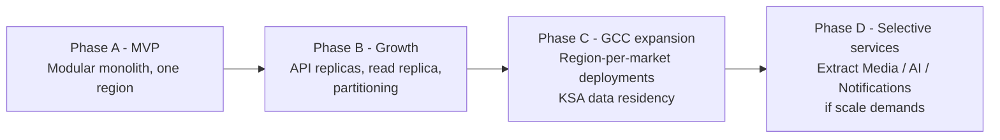
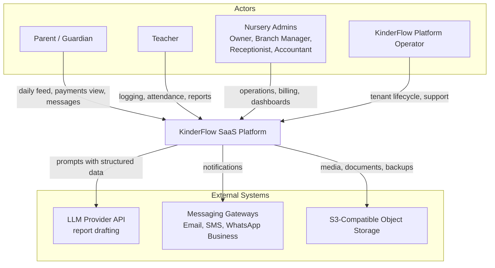
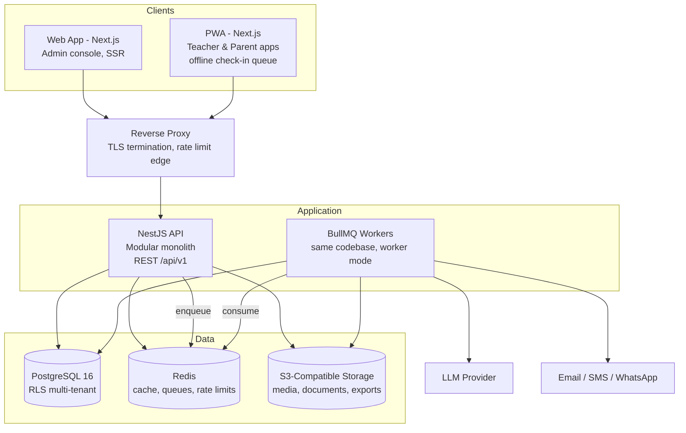
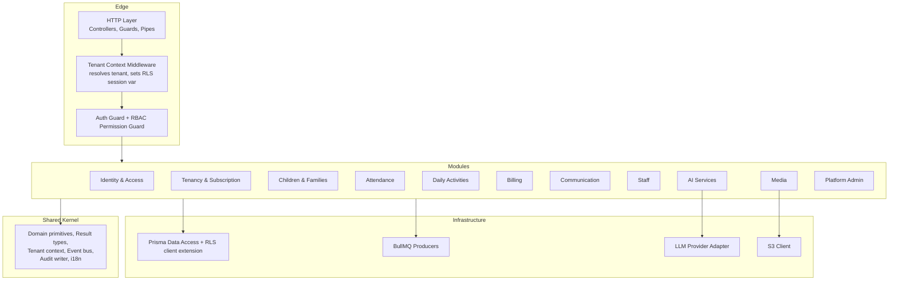
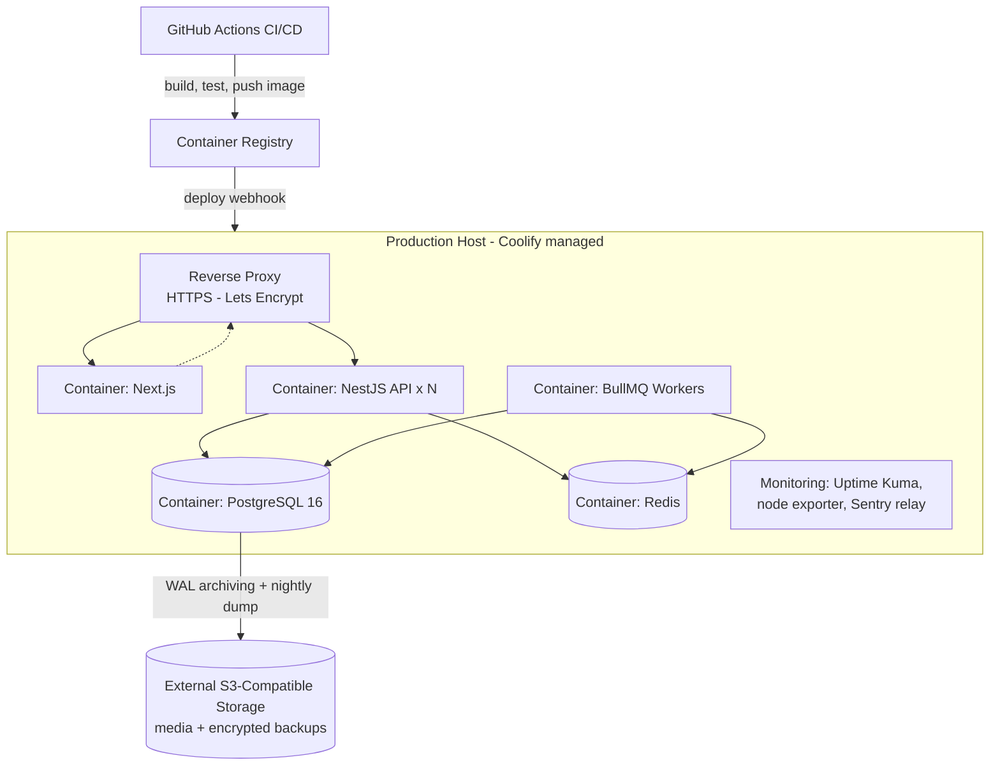
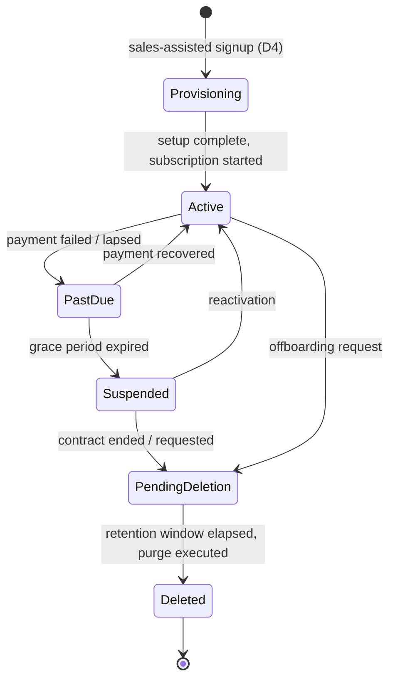
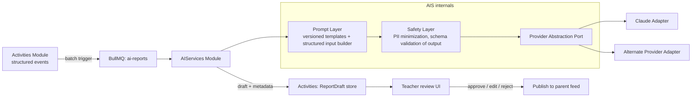
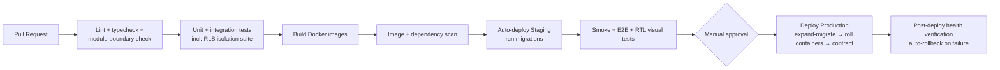

# KinderFlow — Enterprise System Architecture

| Field | Value |
|-------|-------|
| Document | System Architecture Document (SAD) |
| Version | 1.0 |
| Date | 2026-07-18 |
| Status | Pending Architecture Review |
| Inputs | BRD v1.1 (approved), DR-001 Founder Decisions |
| ADRs | `docs/Decisions/ADR-001…ADR-009` |

---

## 1. Architecture Vision

### 1.1 Philosophy

One deployable system, many well-bounded modules. KinderFlow is a **modular monolith** built with Clean Architecture: domain logic at the center, frameworks at the edge, module boundaries enforced by public interfaces and events — so the system can be split into services later by *extraction*, not *rewrite*. Every architectural choice is tested against four questions: does it protect child data, does it keep the daily loop fast, does a two-pizza team maintain it, and does it run lean on VPS-class infrastructure.

### 1.2 Goals

| Goal | Architectural consequence |
|------|--------------------------|
| Absolute tenant isolation (BR-16) | PostgreSQL RLS + app-layer tenant guard, isolation tests in CI |
| Daily loop responsiveness | p95 API < 300 ms; async everything non-critical via BullMQ |
| Gate reliability (BRD R-06) | Offline-capable PWA check-in with idempotent sync |
| Arabic-first, Egypt launch, GCC expansion | i18n/RTL day one; region-portable deployment (Docker/Coolify) |
| Small team velocity | Single repo per app, single DB, one deployment unit, boring technology |
| AI trust (BRD R-09) | AI generates drafts only from structured logged events; human approval gate |

### 1.3 Tradeoffs (accepted consciously)

| Tradeoff | Accepted because |
|----------|------------------|
| Monolith limits independent module scaling | Tenant sizes are small; vertical scaling + read replicas cover 3–5 years of growth |
| Shared DB + RLS is less isolated than DB-per-tenant | Operational cost of thousands of DBs is prohibitive for a small team; RLS + tests + audits is industry-proven |
| PWA-first sacrifices native capabilities (iOS push limits) | One codebase now; native in V2 (D3); web push acceptable for Android, in-app + fallback channels for iOS |
| CQRS only in reporting/dashboard paths | Full CQRS/event-sourcing is unjustified complexity at this scale |
| Coolify/VPS instead of managed cloud | Budget constraint; Docker keeps us portable to any cloud later |

### 1.4 Scalability Strategy

Scale in this order, each step deferred until measured need: (1) vertical scaling of app/DB containers; (2) horizontal API replicas behind the reverse proxy (stateless by design, sessions in Redis); (3) PostgreSQL read replica for dashboards/reports; (4) partitioning of high-volume tables (attendance, audit, activities); (5) extraction of the first service (candidates: Media, AI, Notifications — lowest coupling); (6) regional deployments for GCC data-residency needs.

### 1.5 Future Evolution



---

## 2. C4 Architecture

### 2.1 Level 1 — System Context



### 2.2 Level 2 — Containers



### 2.3 Level 3 — Components (NestJS API)



### 2.4 Level 4 — Deployment



Staging mirrors production on a smaller host; development is docker-compose locally. Region strategy: entire stack is host-portable — a KSA deployment is a second Coolify host with its own DB (data residency), not a code change.

---

## 3. Modular Monolith

### 3.1 Module Map

| Module | Responsibility | Depends on (interfaces only) | Emits events | Consumes events |
|--------|----------------|------------------------------|--------------|-----------------|
| **SharedKernel** | Tenant context, domain event bus, Result/Either types, base entity, audit writer, i18n, clock | — | — | — |
| **IdentityAccess** | AuthN (JWT, refresh), users, roles, permissions, sessions, MFA readiness | Tenancy (tenant existence) | `UserCreated`, `LoginSucceeded/Failed`, `RoleAssigned` | `TenantSuspended` |
| **Tenancy** | Organizations, branches, classrooms, subscription plans, quotas, feature flags | — | `TenantProvisioned`, `BranchCreated`, `PlanChanged`, `QuotaExceeded` | — |
| **ChildrenFamilies** | Child profiles, guardians, medical info/alerts, documents, authorized pickup list, consent flags | Tenancy | `ChildEnrolled`, `ChildWithdrawn`, `PickupListChanged` | — |
| **Attendance** | Check-in/out, pickup authorization enforcement, offline sync reconciliation, ratio snapshot | ChildrenFamilies, Staff | `ChildCheckedIn`, `ChildCheckedOut`, `UnauthorizedPickupAttempt`, `LatePickupFlagged` | `ChildWithdrawn` |
| **Activities** | Meals, naps, diapering, mood, photos linkage, daily report lifecycle (draft→approved→published) | ChildrenFamilies, Media | `ActivityLogged`, `ReportApproved`, `ReportPublished` | `ChildCheckedIn` |
| **Billing** | Fee plans, discounts, invoice generation, payments, credits, reminders, aging | ChildrenFamilies, Tenancy | `InvoiceIssued`, `PaymentRecorded`, `InvoiceOverdue` | `ChildEnrolled`, `ChildWithdrawn` |
| **Communication** | Announcements, direct messaging, incident reports, notification dispatch preferences, quiet hours | ChildrenFamilies, Staff | `AnnouncementPublished`, `MessageSent`, `IncidentFiled`, `IncidentAcknowledged` | `ChildCheckedIn/Out`, `ReportPublished`, `InvoiceIssued`, `UnauthorizedPickupAttempt` |
| **Staff** | Staff profiles, branch/classroom assignment, activation state | IdentityAccess, Tenancy | `StaffAssigned`, `StaffDeactivated` | — |
| **AIServices** | Report drafting, prompt registry, provider abstraction, token accounting, quotas | Activities (read model) | `ReportDraftGenerated`, `AiQuotaExceeded` | `ActivityLogged` (batch trigger) |
| **Media** | Upload pipeline, virus/type validation, image processing, consent-aware access URLs, storage quotas | Tenancy (quotas), ChildrenFamilies (consent) | `MediaUploaded`, `StorageQuotaWarning` | `ChildWithdrawn` (media lifecycle) |
| **PlatformAdmin** | Tenant lifecycle ops, subscription administration, break-glass access, platform health | Tenancy, IdentityAccess | `BreakGlassAccessed` | all lifecycle events (ops feed) |

### 3.2 Boundary Rules

1. Modules communicate through **public service interfaces** (`@Public` API of the module) or **domain events** — never by importing another module's internals or touching its tables directly.
2. Each module owns its Prisma models; cross-module reads of hot data use the owning module's query service (CQRS-lite read models for dashboards only).
3. The **Shared Kernel is minimal and frozen-by-review**: additions require an ADR. It contains no business logic.
4. **Events**: in-process synchronous domain events (same transaction where consistency demands, e.g., audit) and asynchronous integration events via BullMQ (notifications, AI, projections). Event payloads are versioned contracts.
5. Every module follows Clean Architecture internally: `domain/` (entities, rules) → `application/` (use cases, ports) → `infrastructure/` (Prisma repositories, adapters) → `presentation/` (controllers, DTOs).
6. Repositories implement application-layer ports; controllers never call Prisma; domain never imports NestJS.

### 3.3 CQRS Scope (justified use only)

Applied to: owner dashboard KPIs (occupancy, revenue, attendance) and billing aging views — materialized read models refreshed on events + scheduled reconciliation. Not applied to: standard CRUD flows. No event sourcing.

---
## 4. Multi-Tenant Strategy

### 4.1 Options Evaluation

| Criterion (weight) | A: Shared DB + Shared Schema + tenant_id + RLS | B: Shared DB + Schema-per-Tenant | C: Database-per-Tenant |
|---|---|---|---|
| Isolation strength (25%) | Good — enforced at DB engine level by RLS policies | Better — namespace separation | Best — physical separation |
| Operational cost @ 1,000+ tenants (25%) | **Low** — one schema, one migration | High — 1,000 schema migrations per release | Very high — fleet of DBs, connection storm |
| Prisma/tooling fit (15%) | **Native** — single schema, RLS via client extension | Poor — Prisma multi-schema per tenant is awkward | Poor — dynamic connection management |
| Cost efficiency (15%) | **Best** — shared resources | Medium | Worst |
| Migration/upgrade speed (10%) | **Minutes** | Hours, partial-failure risk | Hours–days |
| Per-tenant backup/restore (5%) | Harder — logical export by tenant_id | Medium | Trivial |
| Noisy neighbor risk (5%) | Present — mitigated by rate limits/quotas | Present | Absent |
| **Weighted result** | **8.6 / 10 — SELECTED** | 5.9 | 5.1 |

**Decision (ADR-008): Option A — Shared database, shared schema, `tenant_id` on every tenant-scoped table, PostgreSQL Row-Level Security as the enforcement backstop.** Rationale: a small team shipping to thousands of small tenants needs single-migration operations; RLS provides engine-level isolation independent of application bugs; the model is proven at scale by major SaaS platforms. Escape hatch: the largest enterprise tenants (or KSA residency) can be moved to a dedicated deployment of the same stack — the architecture is tenancy-model-portable because all access already goes through the tenant context.

### 4.2 Isolation Mechanics (defense in depth)

| Layer | Mechanism |
|-------|-----------|
| 1. Request edge | Tenant resolved from JWT claims (never from client-supplied IDs); tenant context bound to request scope |
| 2. Application | Prisma client extension automatically injects `tenant_id` filter on every query of tenant-scoped models; writes stamped with tenant context |
| 3. Database | RLS policies on all tenant tables: `USING (tenant_id = current_setting('app.tenant_id')::uuid)`; API DB role has no `BYPASSRLS`; session variable set per transaction from tenant context |
| 4. Storage | S3 keys prefixed `tenants/{tenant_id}/…`; signed URLs generated only through consent- and tenant-checked Media module |
| 5. Verification | CI test suite executes cross-tenant access attempts against every endpoint; release blocked on failure |

### 4.3 Tenant Lifecycle



| Stage | Design |
|-------|--------|
| Provisioning | Idempotent workflow: create org → owner account → default roles → plan/quotas → seed settings (AR/EN, quiet hours, billing cycle). Executed by CS via Platform Admin console; < 5 minutes |
| Migration | One Prisma migration per release for all tenants; expand-and-contract pattern for breaking changes; RLS policy changes are migration-reviewed and tested |
| Backup | Platform-level: nightly full dump + WAL archiving to S3 (encrypted). Tenant-level: on-demand logical export (all rows by tenant_id + S3 prefix manifest) for offboarding/portability |
| Restore | Platform: PITR from WAL (RPO ≤ 15 min). Single tenant: restore dump to scratch DB → extract tenant rows → controlled re-import (runbook, tested quarterly) |
| Suspension | Login blocked for tenant users; data intact; parent read-only grace mode configurable |
| Deletion | Soft-delete → 30-day grace → purge job: DB rows, S3 prefix, search of audit references anonymized; child-record retention (BR-20, 5 years) honored — retained subset moved to sealed archive before purge; deletion certificate issued |

---

## 5. Security Architecture

### 5.1 Authentication & Sessions

| Concern | Design |
|---------|--------|
| Protocol | JWT access tokens, 15-min TTL, signed (RS256, key rotation supported) |
| Refresh | Rotating refresh tokens, 30-day sliding window, httpOnly Secure SameSite=Strict cookies; token-family theft detection → revoke family |
| Storage | Access token in memory (never localStorage); refresh in httpOnly cookie |
| Sessions | Server-side session registry in Redis (jti allowlist) → instant revocation on logout/deactivation/suspension |
| Passwords | Argon2id; policy: min 10 chars, breach-list check, no forced periodic rotation (NIST 800-63B) |
| MFA readiness | TOTP secret fields + enrollment/verification flows designed now, enforced for Owner/PlatformAdmin roles in first post-MVP release |
| Account safety | Progressive lockout with exponential backoff; login notifications; parent invite flow via signed one-time links |

### 5.2 Authorization (RBAC)

Roles: `PlatformAdmin`, `Owner`, `BranchManager`, `Receptionist`, `Accountant`, `Teacher`, `Parent`. Permissions are `resource:action` pairs grouped into role policies; guards evaluate **role → permission → scope** (tenant → branch → classroom → own-children). Teachers resolve only to their assigned classrooms (BR-15); parents only to their own children. Full permission matrix is a Phase 5 (API design) deliverable per module.

### 5.3 Controls Matrix

| Threat/Concern | Control |
|----------------|---------|
| SQL injection | Prisma parameterized queries only; no raw SQL without review; RLS as backstop |
| XSS | React auto-escaping; strict CSP (no inline scripts); sanitization of rich text (announcements) |
| CSRF | SameSite=Strict cookies + double-submit token on cookie-authenticated mutations |
| CORS | Explicit origin allowlist per environment; credentials only to first-party origins |
| Rate limiting | Redis sliding-window: per-IP (edge), per-user, per-tenant; strict tiers on auth endpoints |
| Encryption in transit | TLS 1.2+ everywhere; HSTS |
| Encryption at rest | Encrypted volumes; S3 server-side encryption; field-level encryption for medical notes and national IDs |
| Secrets | Coolify-injected env secrets; never in repo/images; rotation runbook; least-privilege DB roles |
| Audit logs | Append-only `audit_log` (who, what, tenant, entity, before/after hash, IP, at); all sensitive actions (BR list); tamper-evident hash chain; PlatformAdmin actions always audited |
| Break-glass (BR-17) | PlatformAdmin requests tenant access → reason required → time-boxed grant (≤ 4 h) → tenant owner notified → every action audited → auto-expiry |
| Media access | No public objects; short-lived signed URLs issued post consent-check (BR-19) |
| Uploads | Type/size validation, image re-encoding (strips payloads/EXIF GPS), quota check (BR-21) |

---

## 6. Data Architecture

### 6.1 Responsibilities

| Store | Owns | Never used for |
|-------|------|----------------|
| PostgreSQL 16 | System of record: all domain data, audit log, AI prompt/version registry, read models | Media binaries, queues, cache |
| Redis | Cache, sessions/JTI registry, rate-limit counters, BullMQ backing store, pub/sub for realtime feed invalidation | Durable data — Redis loss must never lose business data |
| BullMQ | All async work (see §10) | Synchronous request paths |
| S3-compatible | Media (photos), child documents, invoices PDF, tenant exports, encrypted DB backups | Queryable data |

### 6.2 Caching Strategy

Read-through cache with explicit invalidation on domain events; keys namespaced `t:{tenant_id}:…`. Cached: dashboard KPI read models (60 s TTL), classroom rosters, tenant settings/feature flags, parent feed pages. Never cached: balances at payment time, pickup authorization lists (always fresh read — safety-critical), permissions (short TTL 30 s max).

### 6.3 Indexing & Partitioning

| Concern | Design |
|---------|--------|
| Index convention | Every tenant-scoped table: composite indexes leading with `tenant_id` (e.g., `(tenant_id, child_id, occurred_at)`); FK indexes mandatory; partial indexes for hot states (open invoices, present children) |
| Query budget | p95 < 50 ms per query; `pg_stat_statements` reviewed weekly; no N+1 (Prisma query logging in CI perf tests) |
| Partitioning | Not at MVP. Trigger: `attendance_events`, `activity_logs`, `audit_log` > ~10 M rows → monthly range partitions (design documented now, applied via expand-and-contract) |
| Volumetrics (planning basis) | 1,000 tenants × 80 children × ~20 events/day ≈ 1.6 M rows/day worst case across log tables → partitioning expected year 2 |

### 6.4 Backup & Disaster Recovery

| Parameter | Target |
|-----------|--------|
| RPO | ≤ 15 min (WAL archiving) |
| RTO | ≤ 4 h (documented, rehearsed restore runbook) |
| Backups | Nightly full logical dump + continuous WAL to S3 (different provider/region than primary host); 30 daily, 12 monthly retained; encrypted (age/GPG); restore test monthly in staging |
| DR scenario: host loss | Recreate via Coolify config-as-code + latest image + PITR restore; DNS cutover; runbook target ≤ 4 h |
| DR scenario: region/provider loss | Backups are provider-independent; standby provider account documented; RTO 24 h (accepted at MVP, revisit at GCC expansion) |
| Media | S3 provider redundancy + lifecycle rules; media loss decoupled from DB integrity |

---
## 7. AI Architecture

### 7.1 Service Boundaries

AI lives in one module (`AIServices`) behind a provider-agnostic port. No other module calls an LLM directly. MVP scope: daily-report drafting only (D-scope from BRD); the same pipeline later serves anomaly detection and forecasting.



### 7.2 Design Rules

| Concern | Design |
|---------|--------|
| Input contract | Drafts are generated **only from structured logged events** (meals, naps, mood, activities) — never free-form; child referenced by pseudonymous ID + first name only; no medical data in prompts unless the event requires it |
| Prompt layer | Templates versioned in code (`prompt_id@semver`), rendered with typed inputs; every generation records `prompt_version`, `model`, `input_hash`, tokens, latency |
| Output safety | LLM must return structured JSON matching a schema; validation failure → retry once → fall back to template-based (non-AI) report; output language per parent preference (AR/EN) |
| Approval workflow | BR-13 enforced structurally: drafts land in `pending_review`; publish path requires teacher action; no auto-send code path exists |
| Cost control | Per-tenant daily token quotas by plan (BR-22); batch generation (classroom at once); response caching for identical event sets; nightly cost report per tenant |
| Observability | Metrics: drafts generated, edit-distance before approval (quality proxy), rejection rate, tokens/cost per tenant, provider latency; alert on rejection-rate spike |
| Provider strategy | Primary + fallback adapter; provider chosen per task profile; models swappable via config without code change (ADR-scoped when V2 adds new AI features) |
| Data protection | Zero-retention/no-training API agreements required from provider; PDPL assessment of cross-border LLM calls tracked under BRD F2 |

---

## 8. API Architecture

### 8.1 Conventions

| Topic | Standard |
|-------|----------|
| Style | REST, resource-oriented, JSON; `Accept-Language: ar\|en` honored |
| Base path | `/api/v1` — URI versioning; v1 stable through MVP; deprecation policy: 6-month overlap |
| Naming | Plural kebab-case resources: `/children/{id}/attendance-events` |
| Pagination | Cursor-based (`?cursor=…&limit=…`, max 100); envelope returns `next_cursor`; offset pagination only on small admin tables |
| Filtering | `?filter[status]=overdue&filter[branch_id]=…`; documented per endpoint; no generic query language |
| Sorting | `?sort=-issued_at,amount` |
| Validation | DTO validation at the edge (class-validator), domain rules in use cases; errors list every violation, localized |
| Idempotency | `Idempotency-Key` header required on: check-in/out sync, payment recording, invoice batch runs; keys stored 48 h in Redis; replay returns original result |
| Error model | RFC 7807 problem+json: `{ type, title, status, code, detail, errors[], trace_id }`; stable machine-readable `code` catalog (e.g., `PICKUP_NOT_AUTHORIZED`) |
| Responses | `{ data, meta }` envelope; timestamps ISO-8601 UTC; money as integer minor units + currency code |
| OpenAPI | Generated from decorators, published per environment, CI-diffed — breaking change fails the build |
| Realtime | MVP: polling + push notifications; SSE for live dashboards Phase 2 (kept out of MVP deliberately) |

### 8.2 Offline Check-In Sync (critical sequence)

```mermaid
sequenceDiagram
    participant R as Receptionist PWA
    participant SW as Service Worker Queue
    participant API as NestJS API
    participant PG as PostgreSQL
    Note over R: Network down at the gate
    R->>SW: check-in child A (event stored locally, uuid v7, device time)
    R->>SW: check-in child B
    Note over SW: Network restored
    SW->>API: POST /attendance-events/sync (batch, Idempotency-Key)
    API->>API: validate authorization list per event<br/>resolve clock skew, detect duplicates
    API->>PG: apply events (transaction, RLS session)
    API-->>SW: per-event results: applied / duplicate / conflict
    SW-->>R: reconcile UI; conflicts surfaced to staff
    API->>API: emit ChildCheckedIn events → parent notifications
```

Conflict policy: server time authoritative; duplicate (same child, same direction, ±2 min window) collapsed; authorization is re-validated server-side at sync — an offline check-out to an unauthorized adult is flagged for branch-manager review rather than silently accepted.

---

## 9. Non-Functional Requirements

| NFR | Target (MVP) | Mechanism |
|-----|--------------|-----------|
| Availability | 99.5% monthly (≈3.6 h downtime budget) | Health checks, container auto-restart, zero-downtime deploys (rolling) |
| Reliability | No data loss on Redis failure; queue jobs at-least-once with idempotent handlers | Durable state only in PG/S3 |
| Performance | API p95 < 300 ms, p99 < 800 ms; dashboard < 1.5 s; feed first page < 500 ms | Read models, caching, index budget |
| Latency (Egypt) | Hosting region chosen for < 60 ms RTT from Cairo (F4: EU-South/local) | Region decision gate |
| Scalability | 1,000 tenants / ~80k children / ~5k concurrent morning check-ins without re-architecture | §1.4 ladder; load test before launch |
| Offline support | Check-in/out and activity logging queue offline ≥ 24 h; sync idempotent | PWA service worker + §8.2 |
| Accessibility | WCAG 2.1 AA on parent/teacher surfaces | Component library discipline (shadcn/ui + audit) |
| Localization | AR (RTL) + EN full parity: UI, notifications, invoices, AI reports; Arabic-first content QA | i18n layer in Shared Kernel; RTL visual test suite |
| Observability | Structured JSON logs (pino) with `trace_id`, `tenant_id`; metrics (Prometheus format); error tracking (Sentry); uptime (Uptime Kuma) | §11 |
| Logging policy | No child PII in logs; request/audit correlation via trace_id; 30-day app logs, audit log retained per BR-20 horizon |
| Maintainability | Module-boundary lint rules (dependency-cruiser), ≥ 80% coverage on domain/application layers, ADR discipline | CI gates |
| DR / BCP | RPO 15 min, RTO 4 h; paper fallback procedure documented for gate operations (BRD R-06) | §6.4 + ops runbooks |

---

## 10. Background Jobs (BullMQ)

### 10.1 Queue Topology

| Queue | Jobs | Priority | Concurrency notes |
|-------|------|----------|-------------------|
| `notifications` | Push/email/SMS dispatch, quiet-hours scheduling | High | Per-provider rate caps; parent-facing latency < 30 s |
| `invoicing` | Cycle-date batch generation, overdue status transitions | High (scheduled) | One batch job per tenant per cycle; idempotent by (tenant, cycle) |
| `ai-reports` | Draft generation batches per classroom | Medium | Token-budget aware; backpressure per tenant quota |
| `media` | Image re-encode, thumbnail, EXIF strip, quota accounting | Medium | CPU-bound; separate worker concurrency pool |
| `reminders` | Payment reminders, document-expiry, report-unopened nudges | Low (scheduled) | Configurable per tenant |
| `exports` | Tenant data exports, accounting CSVs, deletion purge manifests | Low | Long-running; progress reporting |
| `cleanup` | Expired sessions/idempotency keys, soft-delete purges, media lifecycle, DLQ triage summaries | Low (cron) | Off-peak windows |

### 10.2 Execution Policy

| Concern | Policy |
|---------|--------|
| Retries | Exponential backoff with jitter: 5 attempts (notifications: 8); non-retryable error classes fail fast |
| Idempotency | Every handler idempotent via natural keys (e.g., `invoice:{tenant}:{cycle}:{child}`); required for at-least-once semantics |
| Dead Letter Queue | Per-queue DLQ; alert at first DLQ entry for `invoicing`/`notifications`; weekly triage for low-priority queues; replay tooling in Platform Admin |
| Scheduling | BullMQ repeatable jobs (cron) for cycles/reminders/cleanup; tenant-timezone aware (Africa/Cairo default) |
| Isolation | Job payloads carry `tenant_id`; workers establish RLS session context exactly like HTTP requests — same isolation guarantees |
| Observability | Queue depth, job duration, failure-rate metrics exported; stalled-job detection alerts |

---
## 11. Deployment Architecture

### 11.1 Environments

| Environment | Purpose | Notes |
|-------------|---------|-------|
| Development | Local docker-compose: PG, Redis, MinIO, mailpit | Seed data script; feature parity with prod services |
| Staging | Coolify, small host; mirrors prod topology | Anonymized seed (never prod child data); restore-test target; smoke + E2E gate |
| Production | Coolify, dedicated host(s); region per §1.4/F4 | Zero-downtime rolling deploys; backups per §6.4 |

### 11.2 CI/CD Pipeline (GitHub Actions)



| Concern | Design |
|---------|--------|
| Migrations | Expand-and-contract; migrations run as pre-deploy job; RLS policy changes require review label |
| Env config | Twelve-Factor: all config via env vars; `.env.example` documented; secrets only in Coolify secret store |
| Health checks | `/health/live` (process), `/health/ready` (PG, Redis, S3 reachability); proxy routes only to ready containers |
| Rollback | Previous image retained; one-click Coolify rollback; DB rollback via expand-contract discipline (no destructive migration in same release) |
| Monitoring stack | Uptime Kuma (external probes), node/postgres exporters → Prometheus + Grafana dashboards, Sentry (API + frontend), BullMQ board (admin-only) |
| Alerting | Downtime, error-rate spike, queue depth, DLQ entries, disk >80%, backup failure, cert expiry — routed to on-call channel |
| Auto backup | Coolify scheduled DB dumps + WAL shipping (§6.4); backup success is a monitored metric, not an assumption |

---

## 12. Architecture Decision Records

Full ADRs in `docs/Decisions/` (one file each). Summary:

| ADR | Decision | Key rationale |
|-----|----------|---------------|
| ADR-001 | NestJS for backend | Structured DI + module system maps 1:1 to modular monolith; TS end-to-end; mature ecosystem (guards, OpenAPI, BullMQ integration) |
| ADR-002 | Prisma ORM | Type-safe data access, single-schema migration flow fits RLS tenancy; client extensions enable tenant-guard middleware |
| ADR-003 | PostgreSQL | RLS is the tenancy backstop; ACID for billing; JSONB flexibility; partitioning path; boring and proven |
| ADR-004 | BullMQ | Redis-based, TS-native, repeatable jobs + DLQ patterns; no extra broker to operate |
| ADR-005 | Redis | One system for cache, sessions, rate limits, queues — minimal ops surface on VPS budget |
| ADR-006 | Docker (+ Compose locally) | Environment parity, Coolify-native deploys, provider portability for GCC region strategy |
| ADR-007 | Modular Monolith | Team size, deployment simplicity, extraction-ready boundaries; microservices deferred by evidence, not fashion |
| ADR-008 | Shared DB + shared schema + RLS | §4.1 decision matrix; single-migration ops at 1,000+ tenants; engine-level isolation |
| ADR-009 | PWA-first | Founder decision D3; one codebase, no store gatekeeping at MVP; native V2 for push/biometrics depth |

---

## 13. Technical Risks

| ID | Category | Risk | L | I | Mitigation |
|----|----------|------|---|---|-----------|
| TR-01 | Security | RLS misconfiguration on a new table → cross-tenant exposure | M | Critical | Migration linter requiring RLS policy for tenant tables; CI isolation suite; quarterly external review |
| TR-02 | Architecture | Module boundary erosion → distributed big-ball-of-mud | M | H | dependency-cruiser CI rules; ADR gate for Shared Kernel changes; boundary review in PR template |
| TR-03 | Performance | Morning check-in spike (07:00–09:00 Cairo) saturates API | M | H | Load test to 5k concurrent; queue-based write path; horizontal API replicas ready |
| TR-04 | Scaling | Single PG node write ceiling | L (yr 1–2) | H | Vertical headroom, read replica for dashboards, partitioning plan pre-designed (§6.3) |
| TR-05 | Infra | Single-host Coolify production = single point of failure | H | M | Accepted at MVP with 4 h RTO; multi-host from first 100 paying tenants; config-as-code rebuild |
| TR-06 | Data | Offline sync conflicts corrupt attendance trust | M | M | §8.2 conflict policy, immutable events + amendments (BR-12), staff-visible reconciliation |
| TR-07 | AI | Provider outage/latency degrades daily reports | M | M | Fallback provider adapter + non-AI template fallback; reports are async, not blocking |
| TR-08 | Compliance | PDPL constraints invalidate hosting/LLM choices | M | H | F2/F4 gates before launch; region-portable stack; zero-retention LLM contracts |
| TR-09 | Cost | Media storage + LLM tokens outpace plan pricing | M | M | Quotas (BR-21/22), per-tenant cost telemetry from day one, plan pricing review at 90 days |
| TR-10 | Delivery | Prisma + RLS session-variable integration is non-trivial | M | M | Spike in first sprint; client-extension pattern proven before feature work; fallback: app-layer-only guard + pgtap tests |

---

## 14. Technical Debt Register (anticipated, accepted consciously)

| ID | Debt | Priority | Planned resolution |
|----|------|----------|--------------------|
| TD-01 | Manual payment recording (no gateway) | High | Phase 2: Egyptian gateway integration (F3); billing module ports designed for it now |
| TD-02 | iOS push limitations under PWA | High | V2 native apps (D3); interim: in-app inbox + SMS/WhatsApp critical alerts |
| TD-03 | Single-region, single-host production | High | Multi-host at traction milestone; region-per-market at GCC entry |
| TD-04 | No read replica; dashboards share primary | Medium | Add replica when dashboard p95 breaches budget |
| TD-05 | Polling instead of SSE/WebSocket realtime | Medium | SSE in Phase 2 for live dashboards |
| TD-06 | Partitioning deferred | Medium | Pre-designed; execute at row-count trigger |
| TD-07 | Sales-assisted-only onboarding tooling | Medium | Self-serve onboarding when GTM shifts (D4 revisit) |
| TD-08 | Simplified admission flow (no pipeline/waitlist CRM) | Low | Phase 2 enrollment module per BRD |
| TD-09 | Single LLM provider agreement at launch | Low | Second provider contract before GCC scale |

---

## Architecture Review

The architecture satisfies every BRD v1.1 driver: tenant isolation is layered (app guard + RLS + CI verification, TR-01 mitigated structurally); the daily loop is protected by async-first design and an offline-capable gate path (R-06); AI trust is enforced by construction (no auto-publish code path, structured inputs only); Egypt/GCC strategy is served by region-portable Docker/Coolify deployments and AR-first NFRs. Complexity is deliberately suppressed: no microservices, no event sourcing, CQRS confined to dashboards, one database technology per job. The two highest-attention items for the next phase are the Prisma↔RLS integration spike (TR-10) and volumetric validation of the indexing/partitioning plan during Domain Model & Database Design.

## Architecture Score

**92 / 100** — Deductions: single-host production SPOF accepted at MVP (−3, TR-05), PDPL hosting/LLM decisions still gated externally (−3, TR-08/F2/F4), Prisma-RLS pattern unproven in-repo until the spike (−2, TR-10).

## Approval Checklist

| Item | Owner | Status |
|------|-------|--------|
| Architecture principles & tradeoffs (§1) | Founder + Tech Lead | ☐ |
| Multi-tenant decision — Shared schema + RLS (§4, ADR-008) | Founder + Tech Lead | ☐ |
| Security architecture incl. break-glass (§5) | Tech Lead | ☐ |
| NFR targets (§9) | Founder | ☐ |
| Queue topology & job policies (§10) | Tech Lead | ☐ |
| Deployment & environments (§11) | Tech Lead | ☐ |
| ADR-001…009 | Tech Lead | ☐ |
| Risk acceptances TR-05, TR-08 (§13) | Founder | ☐ |

## Next Recommended Phase

**Phase 4 — Domain Model & Database Design** (`docs/04_Database_Design`): per-module domain models (entities, aggregates, invariants), full ERD, Prisma schema design (no code generation — design artifact), RLS policy catalog per table, index plan, migration/seed strategy, and the Prisma↔RLS spike report (TR-10). Follows directly from §3 module boundaries and §4 tenancy mechanics.

