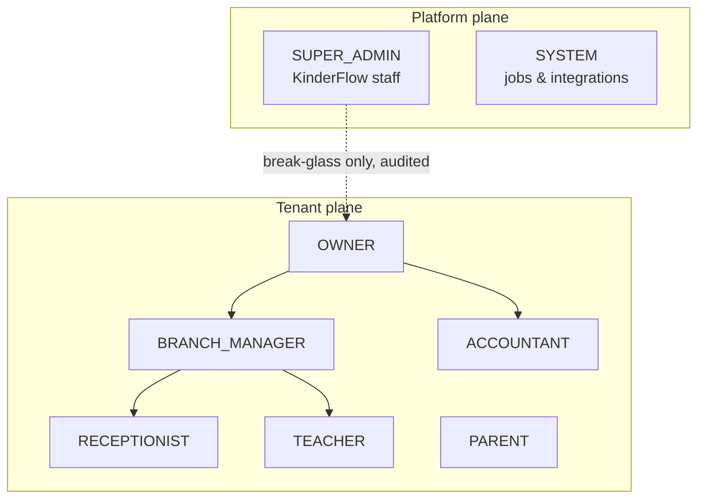
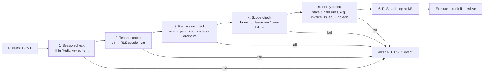

# KinderFlow — Security, RBAC & Permission Architecture

| Field | Value |
|-------|-------|
| Document | Authorization Architecture (Phase 4.5) |
| Version | 1.0 |
| Date | 2026-07-18 |
| Status | Pending Review |
| Inputs | SAD v1.0 §5, Domain Model v1.0 (Parts 3, 6), BRD v1.1 (BR-15/16/17) |
| Downstream | Phase 5 API contracts consume the permission codes defined here |

---

## 1. Identity Architecture

### 1.1 Identity Objects

| Object | Design |
|--------|--------|
| User | One `users` row per person per organization (tenant-scoped); platform staff carry `tenant_id NULL`. Identity = email (unique per tenant) + verified phone for parents. A guardian becomes a User only on invitation acceptance (`guardians.user_id` link) — guardianship exists independently of login capability |
| Organization / Branch | Authorization *scopes*, not identities. Every session is bound to exactly one organization; users never span tenants (a person with two roles at two nurseries = two accounts — accepted tradeoff for isolation simplicity) |
| Session | Server-registered: JWT `jti` allowlisted in Redis; revocable individually (logout), per-user (deactivation), per-tenant (suspension). Access token 15 min; absolute session cap 12 h for admin roles, 30 days sliding for parent/teacher PWA |
| Device | `refresh_token_families.device_fingerprint` (user-agent hash + platform label) — supports per-device revocation UI and theft detection; full device-management deferred to native apps (V2) |
| Refresh tokens | Rotating families (SAD §5.1): reuse of a rotated token revokes the whole family and raises `SEC-TOKEN-REUSE` (§7) |
| API keys (future) | Reserved design: `api_keys` table — tenant-scoped, hashed secret, permission-subset scoping, expiry, last-used tracking; never a user impersonation — keys hold their own permission set. Not built at MVP |
| MFA readiness | TOTP enrollment/verification flows + `mfa_enrollments` table designed now; enforcement flag per role — enabled first for SuperAdmin and Owner post-MVP; recovery codes single-use, hashed |
| Password policy | Argon2id; ≥10 chars; breach-list check at set time; no periodic forced rotation (NIST 800-63B); rate-limited attempts with progressive lockout; reset via signed one-time link (15-min TTL, single use, invalidates sessions on completion) |

### 1.2 Token Claims (JWT payload contract)

| Claim | Content | Note |
|-------|---------|------|
| `sub` | user id | |
| `tid` | tenant (organization) id | **Sole source of tenant context** — never client-supplied elsewhere |
| `rls` | role codes array | e.g., `["BRANCH_MANAGER"]` |
| `scp` | scope bindings | `[{level:"branch", id:…}]` — resolved server-side each request against `user_roles` when stale-sensitive |
| `jti` | session id | Redis allowlist check |
| `ver` | permissions version | Bumped on role/permission change → forces claim refresh mid-session |

Permissions themselves are **not** embedded in the JWT (size + staleness); guards resolve role→permissions from cached reference data (30 s TTL, SAD §6.2).

---

## 2. RBAC Model

### 2.1 Role Hierarchy

Hierarchy is **administrative** (who can manage whom), not permission inheritance — each role's permission set is explicit (no implicit supersets; Owner receives all tenant permissions by explicit grant). PARENT is deliberately outside the staff tree. SYSTEM is the identity of background jobs — carries tenant context per job, permissions limited to its queue's purpose.

### 2.2 Authorization Evaluation (every request)

### 2.3 Scopes & Ownership

| Scope level | Held by | Resolution |
|-------------|---------|-----------|
| `tenant` | OWNER, ACCOUNTANT | All branches of the organization |
| `branch` | BRANCH_MANAGER, RECEPTIONIST | `user_roles.branch_id`; multi-branch grants = multiple rows |
| `classroom` | TEACHER | `user_roles.classroom_id` via staff_assignments; BR-15 |
| `own-children` | PARENT | `child_guardians` join — parent resolves only to linked, non-withdrawn children |
| `platform` | SUPER_ADMIN, SYSTEM | Tenant-null; tenant data only via break-glass (BR-17) or job context |

Ownership rules: authors may edit their own drafts (activities before report approval, messages within 15-min recall window); "recorded_by" fields are immutable attribution, never authorization.

### 2.4 Permission Naming

`{resource}:{action}` codes — actions: `read`, `create`, `update`, `delete` (soft), `approve`, `export`, `restore`, `archive` + special (`invoice:issue`, `attendance:amend`, `report:publish`, `breakglass:request`). The Phase 5 API contract maps every endpoint to exactly one code.

---
## 3. Permission Matrix

Notation: **C**reate · **R**ead · **U**pdate · **D**elete(soft) · **A**pprove · **E**xport · **Rs** Restore · **Ar** Archive. Scope suffix: `ᵀ` tenant · `ᴮ` branch · `ᶜ` classroom · `ᴼ` own(-children / own-authored). `—` = no access. SUPER_ADMIN column reflects **break-glass mode only** (otherwise no tenant data access); SYSTEM lists job-context permissions.

| Resource | OWNER | BRANCH_MGR | TEACHER | RECEPTIONIST | ACCOUNTANT | PARENT | SUPER_ADMIN | SYSTEM |
|---|---|---|---|---|---|---|---|---|
| Organization profile & settings | R U ᵀ | R ᴮ | — | — | R ᵀ | — | R U (bg) | R |
| Branches | C R U Ar ᵀ | R U ᴮ | — | R ᴮ | R ᵀ | — | R (bg) | R |
| Classrooms | C R U Ar ᵀ | C R U Ar ᴮ | R ᶜ | R ᴮ | R ᵀ | — | R (bg) | R |
| Users (staff accounts) | C R U D Rs ᵀ | C R U ᴮ (staff below self) | R ᴼ (self) | R ᴼ | R ᴼ | R ᴼ | R U (bg) | — |
| Role assignments | C R U D ᵀ | C R U ᴮ (TE/RC only) | — | — | — | — | R (bg) | — |
| Children (profiles) | C R U D Rs Ar ᵀ | C R U ᴮ | R ᶜ | C R U ᴮ | R ᵀ (billing fields) | R ᴼ | R (bg) | R |
| Guardians | C R U ᵀ | C R U ᴮ | R ᶜ (contact only) | C R U ᴮ | R ᵀ | R U ᴼ (self) | R (bg) | R |
| Authorized pickups | R ᵀ · A | C R U D ᴮ · A | R ᶜ | R ᴮ (verify only) | — | C R U D ᴼ (own child, pending approval) | R (bg) | R |
| Medical records | R ᵀ | C R U ᴮ | R ᶜ (alerts) | R ᴮ (alerts) | — | C R U ᴼ | R (bg) | R (alerts for jobs) |
| Consents | R ᵀ E | R U ᴮ | R ᶜ | C R U ᴮ | — | R U ᴼ | R (bg) | R |
| Child documents | C R U D ᵀ E | C R U D ᴮ | — | C R U ᴮ | — | C R ᴼ | R (bg) | — |
| Attendance days/events | R ᵀ E | R ᴮ · A (amendments) | C R ᶜ | C R ᴮ | R ᵀ | R ᴼ | R (bg) | C (day-close job) R |
| Attendance amendments | R ᵀ | C A ᴮ | C ᶜ (request only) | C ᴮ (request only) | — | — | R (bg) | — |
| Activity entries | R ᵀ | R ᴮ | C R U ᴼᶜ (until report approval) | R ᴮ | — | R ᴼ (published only) | R (bg) | R |
| Daily reports | R ᵀ E | R ᴮ · A | R U A ᶜ (approve = publish gate) | R ᴮ | — | R ᴼ (published) | R (bg) | C (draft trigger) |
| Medication authorizations | R ᵀ | C R U A ᴮ | R ᶜ | C R ᴮ | — | C R ᴼ | R (bg) | R (expiry job) |
| Medication administrations | R ᵀ | R ᴮ | C R ᶜ | — | — | R ᴼ | R (bg) | — |
| Incidents | R ᵀ E | C R U A ᴮ | C R ᴼᶜ | C R ᴮ | — | R ᴼ (own child, approved) | R (bg) | R |
| Media assets | R D ᵀ | R D ᴮ | C R ᶜ | C R ᴮ | — | R ᴼ (consented) | R (bg) | C (processing) R D (lifecycle) |
| Fee plans / components / discounts | C R U Ar ᵀ · A | R ᴮ | — | R ᴮ (assigned plan names) | C R U ᵀ | — | R (bg) | R |
| Fee assignments | C R U ᵀ | R ᴮ | — | R ᴮ | C R U ᵀ | R ᴼ (own child's plan) | R (bg) | R |
| Invoices | R ᵀ E · A (manual discount) | R ᴮ | — | R ᴮ (balance status only) | C R U(draft) ᵀ · issue | R ᴼ | R (bg) | C (cycle job) U (overdue) |
| Payments | R ᵀ E | R ᴮ | — | C R ᴮ (cash receipt) | C R ᵀ | R ᴼ (receipts) | R (bg) | — |
| Credit notes | R ᵀ · A | — | — | — | C R ᵀ | R ᴼ | R (bg) | — |
| Staff members & assignments | C R U D Ar ᵀ | C R U ᴮ | R ᴼ | R ᴮ (roster) | — | — | R (bg) | R (ratio jobs) |
| Conversations & messages | R ᵀ (metadata; content on incident escalation, audited) | R ᴮ (same rule) | C R ᶜ (assigned-parent threads) | C R ᴮ | — | C R ᴼ | R (bg) | C (system messages) |
| Announcements | C R U D ᵀ · A | C R U ᴮ · A | C ᶜ (draft, BM approves) | R ᴮ | — | R ᴼ (audience) | R (bg) | — |
| Notifications & preferences | R ᵀ (delivery stats) | R ᴮ | R U ᴼ (own prefs) | R U ᴼ | R U ᴼ | R U ᴼ | R (bg) | C R U (dispatch) |
| AI report drafts | R ᵀ | R ᴮ | R U ᶜ (edit before approve) | — | — | — | R (bg) | C (generation) |
| AI configuration & quotas | R ᵀ | — | — | — | — | — | R U (platform plane) | R |
| Analytics / KPI dashboards | R E ᵀ | R ᴮ | — | — | R ᵀ (financial) | — | R (bg) | C R U (projections) |
| Audit log | R ᵀ (read-only UI) E | R ᴮ (operational subset) | — | — | R ᵀ (financial subset) | — | R (platform + bg) | C (writer) |
| Subscription & plan | R ᵀ | — | — | — | R ᵀ | — | C R U (platform plane) | R U (billing jobs) |
| Feature flags | R ᵀ (own overrides) | — | — | — | — | — | C R U D (platform) | R |
| Tenant exports | C R ᵀ (request) · A | — | — | — | R ᵀ (financial exports) | — | C R A (platform, offboarding) | C (executor) |
| Break-glass grants | R ᵀ (notified, sees history) | — | — | — | — | — | C (request) R | — |

Deletion note: `D` is always soft delete; hard deletion exists only for SYSTEM via retention/purge jobs (Domain Model §4.3) — **no human role can hard-delete anything**. `Rs` (restore) mirrors `D` holders except where legal records forbid restore (attendance, payments — no D at all).

---

## 4. Field-Level Permissions

Enforced at DTO serialization (read) and command validation (write) — the policy layer of §2.2 step 5.

| Rule ID | Rule | Mechanism |
|---------|------|-----------|
| FL-01 | Teacher never sees or edits financial data (invoices, payments, fee amounts) — even for own classroom's children | Billing fields absent from teacher-facing child DTOs |
| FL-02 | Parent resolves only own children — all child-scoped queries join through `child_guardians`; group photos require per-child consent intersection (BR-19) | Own-children scope + consent filter in Media |
| FL-03 | Receptionist sees invoice **status/balance** (to answer "do I owe?") but not line items, discounts, or financial reports | Restricted DTO variant |
| FL-04 | Accountant reads attendance (billing basis: billable days) but cannot create/update/amend attendance | No write permission codes granted |
| FL-05 | Medical detail (conditions, notes) visible to BM + assigned teacher as **alert summary** only; full record to Owner/BM and parent; encrypted fields (SAD §5.3) decrypted only for authorized DTOs | Field-level encryption + DTO variants |
| FL-06 | National IDs (guardians/pickups): stored encrypted, displayed masked (last 4) except to Owner/BM during pickup-identity verification flow | Masking serializer |
| FL-07 | Teacher edits own activity entries only until report approval freezes them (Domain §2.5) | State policy |
| FL-08 | Staff salary-adjacent fields (future payroll) reserved Owner-only from day one | Schema annotation |
| FL-09 | Message content: Owner/BM see thread **metadata** only; content access requires incident escalation and is itself audited | Escalation flow + audit |
| FL-10 | AI draft internals (prompt version, token counts) visible to platform plane only; teachers see draft text | DTO separation |

---

## 5. AI Permissions

| Capability | Allowed | Notes |
|-----------|---------|-------|
| Trigger draft generation | SYSTEM (scheduled batch), TEACHER ᶜ (manual re-draft for own classroom) | Quota-guarded (BR-22) |
| Edit / approve / publish AI drafts | TEACHER ᶜ (the approval **is** the publish gate, BR-13); BRANCH_MANAGER ᴮ may approve in teacher absence (audited delegation) | No other role can publish |
| View AI insights (future anomaly/forecast) | OWNER ᵀ, BRANCH_MANAGER ᴮ (operational subset) | Financial anomalies Owner+Accountant |
| Configure AI (models, prompts, quotas) | SUPER_ADMIN (platform plane) only | Tenants get on/off + language preference in settings (OWNER) |
| Export AI results | OWNER ᵀ (within report exports) | Drafts excluded from parent-facing exports; only approved content exports |
| View AI usage/cost | OWNER ᵀ (own tenant), SUPER_ADMIN (all) | ai_usage_daily |

---
## 6. Audit Strategy (authorization view)

Complements Domain Model Part 7 (storage design).

| Question | Answer |
|----------|--------|
| What is audited | Every action in the §7 event catalog; every C/U/D/A/E on: children, guardians, pickups, medical, consents, attendance amendments, invoices, payments, credit notes, role assignments, settings, fee plans; every read of: message content by admins (FL-09), full medical records by staff, audit log itself (meta-audit), any break-glass session (all actions); every export |
| What is NOT audited | High-volume routine reads (feeds, rosters, dashboards) — covered by structured access logs (30-day) instead of the 5-year audit trail; prevents audit dilution |
| Who reads audit logs | OWNER: full tenant trail (read-only UI + export). BRANCH_MANAGER: operational subset for own branch (no financial). ACCOUNTANT: financial subset. SUPER_ADMIN: platform actions + tenant trails under break-glass. No role can write/edit/delete audit rows — INSERT-only DB grant to SYSTEM writer |
| Retention | 5 years rolling (aligned D8/BR-20); monthly partitions → encrypted S3 parquet archive → drop (Domain §7) |
| Tamper protection | Per-tenant hash chain (`row_hash = H(prev_hash ‖ row)`) verified by scheduled integrity job; chain-head anchors exported daily to separate storage account; INSERT-only grants; audit writer is the only path (Shared Kernel port) |

## 7. Security Event Catalog

Event codes are stable, machine-readable, and feed three sinks: audit_log (5y), SIEM-ready structured log stream, and alerting rules (→ on-call).

| Code | Event | Severity | Alert |
|------|-------|----------|-------|
| SEC-AUTH-001 | Login succeeded | Info | — |
| SEC-AUTH-002 | Login failed | Info | ≥5/user/10min → warn; ≥20/IP → block+alert |
| SEC-AUTH-003 | Logout | Info | — |
| SEC-AUTH-004 | Account locked (progressive lockout) | Warn | User notified |
| SEC-AUTH-005 | Password reset requested / completed | Warn | User notified on completion |
| SEC-AUTH-006 | MFA enrolled / removed | Warn | User + Owner notified on removal |
| SEC-TOKEN-001 | Refresh token rotated | Info | — |
| SEC-TOKEN-002 | **Rotated token reuse (theft signal)** — family revoked | Critical | On-call + user forced re-auth |
| SEC-SESS-001 | Session revoked (admin action / deactivation) | Warn | — |
| SEC-PERM-001 | Role assigned / changed / revoked | Warn | Owner digest |
| SEC-PERM-002 | Permission denied (403) | Info | Pattern: ≥10/user/hour → warn (probing) |
| SEC-PERM-003 | **Cross-tenant access attempt blocked** (RLS or guard) | Critical | On-call immediately — should never fire |
| SEC-DATA-001 | Export requested / completed (any export permission) | Warn | Owner notified |
| SEC-DATA-002 | Bulk read anomaly (volume threshold per role) | Warn | Review queue |
| SEC-DATA-003 | Child record / medical / consent modified | Info→audit | — |
| SEC-FIN-001 | Invoice issued / manual discount approved | Info→audit | Manual discount → Owner digest |
| SEC-FIN-002 | Payment recorded / credit note issued | Info→audit | — |
| SEC-SAFE-001 | **Unauthorized pickup attempt** (BR-01 block) | Critical | Guardian + BM immediately |
| SEC-SAFE-002 | Incident created / acknowledged | Warn→audit | Per BR-14 flow |
| SEC-SAFE-003 | Pickup list changed | Warn→audit | Guardian notified |
| SEC-PLAT-001 | Break-glass requested / granted / expired | Critical→audit | Tenant Owner notified real-time |
| SEC-PLAT-002 | Tenant suspended / reactivated / deletion requested | Warn | Owner + CS |
| SEC-PLAT-003 | Audit chain integrity check failed | Critical | On-call + freeze investigation |
| SEC-MSG-001 | Admin accessed message content (FL-09 escalation) | Warn→audit | Logged with incident ref |

---

## Security Matrix (defense summary)

| Attack surface | Controls (layered) |
|----------------|--------------------|
| Credential attacks | Argon2id + breach-list + lockout + MFA-ready + reset-link hygiene |
| Session/token theft | 15-min access TTL, rotation + family revocation (SEC-TOKEN-002), jti allowlist, httpOnly cookies |
| Privilege escalation | Explicit permission codes (no inheritance), scope checks, `ver` claim forcing refresh on change, role-assignment audit |
| Cross-tenant | 5 layers (SAD §4.2) + tenant-composite FKs + SEC-PERM-003 tripwire |
| Insider (staff overreach) | Least-privilege matrix (§3), field-level rules (§4), message-content escalation audit (FL-09), export notifications |
| Platform insider | Break-glass only, time-boxed, owner-notified, fully audited (BR-17) |
| Data exfiltration | Export permissions narrow + audited + notified; bulk-read anomaly detection (SEC-DATA-002) |
| Tampering | Append-only audit + hash chain + anchor export (SEC-PLAT-003) |

## Approval Checklist

| Item | Owner | Status |
|------|-------|--------|
| Identity & session design (§1) | Tech Lead | ☐ |
| Role hierarchy & scope model (§2) | Founder + Tech Lead | ☐ |
| Permission matrix — every row (§3) | Founder (business correctness) | ☐ |
| Field-level rules FL-01…FL-10 (§4) | Founder | ☐ |
| AI permissions (§5) | Founder | ☐ |
| Audit scope & retention (§6) | Founder + Legal (F2) | ☐ |
| Security event catalog & alert thresholds (§7) | Tech Lead | ☐ |

## Readiness Score

**93 / 100** — Deductions: alert thresholds are initial estimates needing production tuning (−3); message-content escalation flow (FL-09) needs UX definition in Phase 6 (−2); MFA enforcement timing post-MVP is a residual risk for Owner accounts (−2).

## Next Recommended Phase

**Phase 5 — API Contract Design** (`docs/05_API_Design`): every endpoint mapped to exactly one permission code from §2.4 and one matrix row from §3; DTO variants per role (FL rules); error codes aligned with SEC events; the offline-sync and idempotency contracts; OpenAPI skeleton. The permission matrix in this document is the single source of truth the API layer must conform to.

