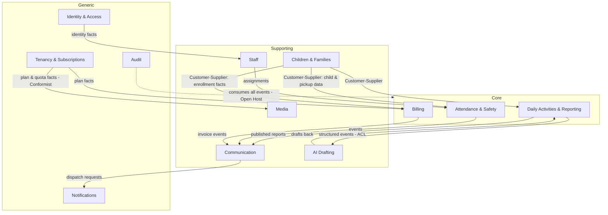
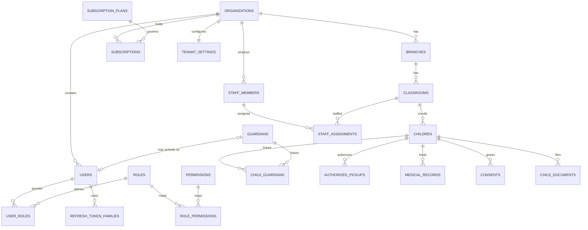
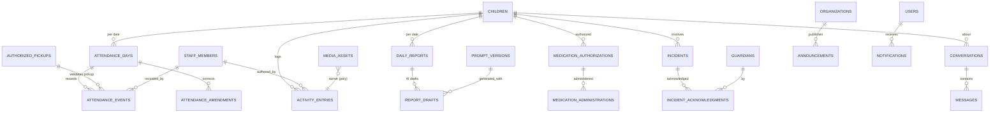
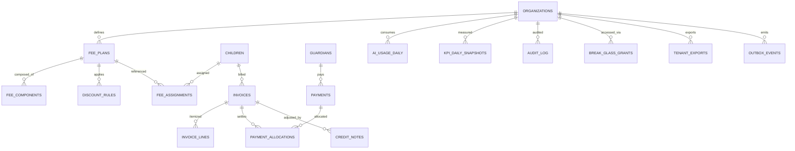

# KinderFlow — Domain Model & Database Design

| Field | Value |
|-------|-------|
| Document | Domain Model & Database Design (Phase 4) |
| Version | 1.0 |
| Date | 2026-07-18 |
| Status | Pending Review |
| Inputs | BRD v1.1, Architecture SAD v1.0 (approved), ADR-001…009 |
| Constraint | Design artifact only — no implementation code; Prisma schema authored in implementation phase from Part 8 |

---

# Part 1 — Strategic Domain-Driven Design

## 1.1 Domain Classification

| Classification | Domains | Rationale |
|----------------|---------|-----------|
| **Core** (competitive advantage — model deeply) | Attendance & Safety · Daily Activities & Reporting · Billing | The daily loop and the gate: safety enforcement (BR-01), the report pipeline that drives retention, and the localized billing engine that is our moat vs. incumbents |
| **Supporting** (necessary, tailored) | Children & Families · Staff · Communication · Media · AI Drafting | Custom to childcare but not differentiating alone; AI drafting is supporting-by-structure (it consumes core data, differentiates the core loop) |
| **Generic** (buy patterns, don't innovate) | Identity & Access · Tenancy & Subscriptions · Notifications dispatch · Audit · Settings · Platform Admin / Analytics | Solved problems; implement with standard patterns, zero creativity |

## 1.2 Bounded Contexts & Context Map

Bounded contexts coincide with the architecture's modules (ADR-007) — one context = one module = one future extraction candidate.

Relationship types: Children & Families is **upstream supplier** to all core contexts (published language: `ChildEnrolled`, `PickupListChanged`). AI Drafting sits behind an **anti-corruption layer** — it receives a purpose-built structured snapshot, never raw Activities internals. Audit is **open-host**: consumes every context's events uniformly. Shared Kernel (Architecture §3.2) carries only: TenantContext, Money, LocalizedText, DomainEvent base, Result, Clock, AuditWriter port.

## 1.3 Aggregate Inventory

| Bounded Context | Aggregate Root | Members (entities/VOs inside boundary) | Invariant protected |
|---|---|---|---|
| Tenancy | **Organization** | Branch, Classroom, TenantSettings VO | Branch belongs to org; classroom capacity/age-range validity |
| Tenancy | **Subscription** | PlanAssignment, QuotaUsage VO | One active subscription per org; quota ≤ plan limit |
| IAM | **UserAccount** | Credential VO, RefreshTokenFamily, MfaEnrollment | Credential rules; token-family integrity |
| IAM | **RoleAssignment** | ScopeBinding VO | Role valid for scope level (tenant/branch/classroom) |
| Children & Families | **Child** | GuardianLink, AuthorizedPickup, MedicalRecord, ConsentSet VO, Document | ≥1 primary guardian (BR-04); pickup list integrity (BR-01 source); consent completeness (BR-19) |
| Children & Families | **Guardian** | ContactChannel VO | Verified contact for primary guardians |
| Attendance | **AttendanceDay** (child × date) | AttendanceEvent, Amendment | No double check-in (BR-11); immutability after day close (BR-12); events strictly ordered |
| Activities | **DailyReport** (child × date) | ActivityEntry refs, DraftRevision | State machine draft→pending→approved→published (BR-13); publish requires approval |
| Activities | **ActivityEntry** | TypedPayload VO (meal/nap/diaper/mood/medication-admin) | Payload schema per type; author must be assigned staff |
| Activities | **MedicationAuthorization** | AdministrationRecord | Administration only within authorization window/dosage |
| Activities | **Incident** | AcknowledgmentRecord, MediaRef | Severity-based approval flow (BR-14) |
| Billing | **FeePlan** | FeeComponent VO, DiscountRule | Component amounts ≥ 0; discount stacking rules (BR-07) |
| Billing | **Invoice** | InvoiceLine, AdjustmentLine | Immutable after issue (BR-08); total = Σ lines; currency single per invoice |
| Billing | **PaymentRecord** | AllocationLine | Allocation ≤ open balance; overpay → credit (BR-09) |
| Billing | **CreditNote** | — | References issued invoice only |
| Staff | **StaffMember** | Assignment (branch/classroom), EmploymentState | Active assignment requires active user account |
| Communication | **Conversation** | Message, ReadMarker | Participants fixed by policy (parent↔teacher scope); quiet-hours queueing (BR-18) |
| Communication | **Announcement** | AudienceSelector VO | Audience within author's scope |
| Media | **MediaAsset** | Variant VO (thumb/web), ConsentCheck ref | No access without consent + tenancy check (BR-19); quota accounting (BR-21) |
| AI | **ReportDraftBatch** | DraftItem, TokenUsage VO | Batch bound to prompt version; tenant quota (BR-22) |
| Audit | **AuditEntry** (append-only) | — | Immutable; hash-chained |
| Platform | **BreakGlassGrant** | ActionRecord | Time-boxed; reason mandatory (BR-17) |

## 1.4 Value Objects (canonical set)

`Money {amount_minor, currency}` · `LocalizedText {ar, en}` · `PhoneNumber` (E.164, EG/GCC validation) · `TimeRange` · `DateOfBirth` (age derivation) · `NationalId` (encrypted at rest) · `ConsentSet {photo_internal, photo_group, data_processing}` · `ScopeBinding {level, branch_id?, classroom_id?}` · `QuotaUsage {used, limit}` · `TypedPayload` (per activity type, JSON-schema validated) · `AudienceSelector {branch|classroom|all}` · `TokenUsage {input, output, cost_minor}`

## 1.5 Domain Events Catalog (published language)

| Context | Events (past tense, versioned `v1`) |
|---|---|
| Tenancy | TenantProvisioned, BranchCreated, PlanChanged, QuotaExceeded, TenantSuspended, TenantDeletionRequested |
| IAM | UserCreated, LoginSucceeded, LoginFailed, RoleAssigned, UserDeactivated |
| Children & Families | ChildEnrolled, ChildWithdrawn, GuardianLinked, PickupListChanged, ConsentChanged, MedicalRecordUpdated |
| Attendance | ChildCheckedIn, ChildCheckedOut, UnauthorizedPickupAttempted, LatePickupFlagged, AttendanceAmended, AttendanceDayClosed |
| Activities | ActivityLogged, ReportDraftRequested, ReportApproved, ReportPublished, MedicationAdministered, IncidentFiled, IncidentAcknowledged |
| Billing | InvoiceIssued, InvoiceOverdue, PaymentRecorded, CreditIssued, FeePlanChanged |
| Communication | MessageSent, AnnouncementPublished, NotificationDispatched |
| Media | MediaUploaded, MediaQuarantined, StorageQuotaWarning |
| AI | ReportDraftGenerated, AiQuotaExceeded |
| Platform | BreakGlassAccessed, TenantExportCompleted |

## 1.6 Tactical Building Blocks per Context

| Block | Convention |
|-------|-----------|
| Repositories | One per aggregate root (`ChildRepository`, `InvoiceRepository`…); interface in application layer, Prisma implementation in infrastructure; no repository for non-root entities |
| Factories | `ChildFactory` (enrollment invariants), `InvoiceFactory` (from fee plan + adjustments), `TenantFactory` (provisioning defaults), `ReportDraftFactory` (from activity snapshot) |
| Domain Services | `PickupAuthorizationService` (BR-01 decision), `DiscountEngine` (BR-07 stacking), `RatioCalculator`, `QuietHoursScheduler` (BR-18), `RetentionPolicyService` (BR-20) |
| Policies (event→command) | OnChildWithdrawn→ scheduleMediaLifecycle + proratеFinalInvoice; OnInvoiceOverdue→ startReminderSequence; OnUnauthorizedPickupAttempted→ notifyGuardians+manager; OnReportApproved→ publishToFeed |
| Specifications | `ChildEligibleForClassroom` (age/capacity, BR-02/03), `InvoiceReadyToIssue`, `PickupWindowOpen`, `TeacherAssignedToClassroom` (BR-15 scope) |

---
# Part 2 — Module-by-Module Domain

Requested fine-grained modules are grouped under their owning bounded context (architecture §3). Format per module: **P**urpose · **A**ggregates/entities · **R**ules · **L**ifecycle · **E**vents · **D**ependencies.

### 2.1 Platform Core (Tenancy: Organization, Branches, Subscriptions, Feature Flags, Settings, Storage quotas)

**P:** Own the tenant hierarchy (organization → branch → classroom), commercial state, and configuration.
**A:** Organization (root: Branch, Classroom); Subscription (root: PlanAssignment, QuotaUsage); `subscription_plans` (global reference data); FeatureFlag (global + tenant overrides); TenantSettings (VO persisted per org).
**R:** BR-02 capacity, BR-22 plan gates, BR-21 storage quotas; org must have ≥1 branch to activate; classroom belongs to exactly one branch; settings carry locale defaults (ar-EG), timezone (Africa/Cairo), quiet hours, billing cycle day.
**L:** Organization: Provisioning→Active→PastDue→Suspended→PendingDeletion→Deleted (SAD §4.3). Classroom: Draft→Active→Archived (archive requires zero enrolled children).
**E:** TenantProvisioned, BranchCreated, PlanChanged, QuotaExceeded, TenantSuspended.
**D:** None (upstream of everything).

### 2.2 Identity & Access (Users, Roles, Permissions)

**P:** Authentication, authorization primitives, session integrity.
**A:** UserAccount (root: Credential, RefreshTokenFamily, MfaEnrollment); RoleAssignment (root: ScopeBinding); `roles`, `permissions`, `role_permissions` (reference data, seeded).
**R:** SAD §5.1 password/session rules; one UserAccount per person per tenant (platform staff are tenant-null); RoleAssignment scope must be consistent (teacher→classroom scope, branch manager→branch scope); deactivation cascades to session revocation instantly.
**L:** User: Invited→Active→Locked→Deactivated. Invitation via signed one-time link (parents).
**E:** UserCreated, RoleAssigned, LoginSucceeded/Failed, UserDeactivated.
**D:** Tenancy (existence/state of org).

### 2.3 Children & Families (Students, Parents, Authorized Pickup, Medical, Documents, Consents)

**P:** Single source of truth for the child record — the platform's most sensitive data.
**A:** Child (root: GuardianLink, AuthorizedPickup, MedicalRecord, Document, ConsentSet); Guardian (root: ContactChannel).
**R:** BR-01 (pickup list is the authorization source), BR-03 (age range), BR-04 (primary guardian), BR-05 (medical alerts surfaced), BR-19 (consents), BR-20 (retention). Guardian ≠ UserAccount (a guardian may exist before app activation); AuthorizedPickup entries carry identity proof descriptor + optional photo; medical alerts are a projection of MedicalRecord flagged entries.
**L:** Child: Admitted→Enrolled→(Paused)→Withdrawn→ArchivedRetention→Purged (5y, D8). Withdrawal triggers billing proration policy + media lifecycle policy.
**E:** ChildEnrolled, ChildWithdrawn, GuardianLinked, PickupListChanged, ConsentChanged, MedicalRecordUpdated.
**D:** Tenancy (classroom refs), Media (document/photo storage via interface).

### 2.4 Attendance & Safety (Check-in/out, Amendments)

**P:** Legally reliable record of presence and custody transfer; the gate.
**A:** AttendanceDay per child×date (root: AttendanceEvent, Amendment).
**R:** BR-01 enforced here at event creation (via PickupAuthorizationService against Children context); BR-11 alternation; BR-12 immutability after `AttendanceDayClosed` — corrections only as Amendment entities referencing the original; offline events re-validated at sync (SAD §8.2), conflicts → `pending_review` state; late pickup per branch closing time + grace.
**L:** AttendanceDay: Open→Closed (nightly close job) — amendments allowed on Closed with manager role.
**E:** ChildCheckedIn/Out, UnauthorizedPickupAttempted, LatePickupFlagged, AttendanceAmended, AttendanceDayClosed.
**D:** ChildrenFamilies (pickup list — always fresh read), Staff (recording staff assignment).

### 2.5 Daily Activities (Activities, Meals, Nap, Medication)

**P:** Structured record of the child's day — the AI substrate and parent-value engine.
**A:** ActivityEntry (root; typed: MEAL, NAP, DIAPER, MOOD, LEARNING, NOTE, MEDICATION_ADMIN); DailyReport per child×date (root: DraftRevision); MedicationAuthorization (root: AdministrationRecord).
**R:** Typed payload schemas (meal: type/items/amount-eaten; nap: start/end; medication: dose/route/time); entries editable by author until report approval, then frozen; MEDICATION_ADMIN requires active MedicationAuthorization (guardian-signed, dose window) — hard block otherwise; report state machine BR-13.
**L:** DailyReport: Empty→Drafting(AI)→PendingReview→Approved→Published; rejection returns to Drafting with teacher notes.
**E:** ActivityLogged, MedicationAdministered, ReportDraftRequested/Generated, ReportApproved, ReportPublished.
**D:** ChildrenFamilies, Staff (author scope BR-15), Media (photo refs), AI (draft port).

### 2.6 Incidents

**P:** Formal record of accidents/behavior events with guardian acknowledgment trail.
**A:** Incident (root: AcknowledgmentRecord, MediaRef).
**R:** BR-14 severity workflow (MINOR auto-notify / SERIOUS manager-approval + phone contact logged); involved children each get their own incident record (privacy — no cross-family leakage); guardian acknowledgment recorded with timestamp+channel.
**L:** Filed→UnderReview→Approved→Notified→Acknowledged→Closed.
**E:** IncidentFiled, IncidentAcknowledged.
**D:** ChildrenFamilies, Staff, Communication (notification), Media.

### 2.7 Billing (Invoices, Payments, Discounts, Fee Plans)

**P:** The revenue engine: fee plans → invoices → payments → aging.
**A:** FeePlan (root: FeeComponent, DiscountRule); Invoice (root: InvoiceLine, AdjustmentLine); PaymentRecord (root: AllocationLine); CreditNote.
**R:** BR-06/07/08/09/10; Money as integer minor units EGP (multi-currency ready via VO); invoice generated per child per cycle from active FeeAssignment; sibling discount auto-derived from guardian's enrolled-children count at generation time (snapshot on invoice line); proration on mid-cycle enroll/withdraw (daily basis); payment allocation FIFO oldest-open-invoice default, manual override allowed; credit balance is derived (Σ unallocated payments + credit notes), never a mutable counter.
**L:** Invoice: Draft→Issued→PartiallyPaid→Paid | Overdue→(CreditAdjusted)→Closed. PaymentRecord immutable once posted (reversal = counter-entry).
**E:** InvoiceIssued, PaymentRecorded, InvoiceOverdue, CreditIssued, FeePlanChanged.
**D:** ChildrenFamilies (enrollment facts), Tenancy (cycle settings, plan gates).

### 2.8 Staff

**P:** Staff registry and scope assignments (teacher→classroom, manager→branch).
**A:** StaffMember (root: Assignment, EmploymentState).
**R:** Assignment requires active UserAccount + role consistency; deactivation revokes sessions + closes assignments; ratio snapshots read assignments.
**L:** Onboarded→Active→Suspended→Terminated (history retained).
**E:** StaffAssigned, StaffDeactivated.
**D:** IAM, Tenancy.

### 2.9 Communication (Messaging, Notifications, Announcements)

**P:** All parent/staff communication rails with auditability and quiet hours.
**A:** Conversation (root: Message, ReadMarker); Announcement (root: AudienceSelector); Notification (dispatch record); NotificationPreference per user.
**R:** Conversation participants constrained by policy (parent↔assigned teacher, parent↔branch admin); BR-18 quiet hours queue non-urgent messages; announcements immutable after publish (corrections = follow-up); notifications are fan-out records with channel, status, retries (SAD §10).
**L:** Message: Queued→Delivered→Read. Notification: Pending→Sent→Delivered/Failed(→DLQ).
**E:** MessageSent, AnnouncementPublished, NotificationDispatched.
**D:** Consumes events from Attendance, Activities, Billing, Incidents; IAM (preferences).

### 2.10 Media & Storage

**P:** Consent-aware, quota-accounted media pipeline.
**A:** MediaAsset (root: Variant); StorageQuota usage tracked on Subscription aggregate (Tenancy).
**R:** BR-19 consent check on every access-URL issuance; BR-21 quota block on upload; processing pipeline: validate→re-encode/EXIF-strip→variants→attach; assets referenced by Activities/Incidents/Children documents via owned refs; child-withdrawal triggers lifecycle (retain per BR-20, then purge with child record).
**L:** Uploading→Processing→Ready | Quarantined→Purged.
**E:** MediaUploaded, MediaQuarantined, StorageQuotaWarning.
**D:** Tenancy (quota), ChildrenFamilies (consent read).

### 2.11 AI (Drafting)

**P:** Draft generation bounded context — provider-abstracted, quota-guarded (SAD §7).
**A:** ReportDraftBatch (root: DraftItem, TokenUsage); PromptVersion (reference data, code-managed, DB-registered for audit).
**R:** Input = structured activity snapshot only; output schema-validated; drafts never publish (BR-13 structural); per-tenant daily token quota by plan.
**L:** Batch: Requested→Generating→Completed/PartiallyFailed→Consumed.
**E:** ReportDraftGenerated, AiQuotaExceeded.
**D:** Activities (ACL snapshot), Tenancy (quota).

### 2.12 Analytics

**P:** CQRS-lite read models for owner dashboards (SAD §3.3).
**A:** `kpi_daily_snapshots` (branch×date grain: occupancy, attendance, revenue, collections, engagement) — projection, rebuildable from source events; not a system of record.
**R:** Refreshed on events + nightly reconciliation; queries never touch operational aggregates.
**D:** Consumes events from all core contexts.

### 2.13 Audit

**P:** Tamper-evident, append-only record of sensitive actions (SAD §5.3).
**A:** AuditEntry (append-only; hash-chained per tenant).
**R:** Never updated/deleted inside retention horizon; platform-admin actions always audited; BreakGlassGrant records wrap PlatformAdmin tenant access (BR-17).
**D:** Open-host consumer of all contexts.

---
# Part 3 — Entity Catalog

Legend: **T** = tenant-scoped (tenant_id + RLS) · **SD** = soft delete · **AU** = row audited to audit_log · **OL** = optimistic locking (version column). All tables have `id` (UUIDv7), `created_at`, `updated_at`. Statuses are PostgreSQL enums.

| # | Table | Aggregate / Owner | T | SD | AU | OL | Status field | Key indexes (beyond PK/FK) | Notes / validation highlights |
|---|-------|-------------------|---|----|----|----|--------------|---------------------------|-------------------------------|
| 1 | organizations | Organization (Tenancy) | self | ✔ | ✔ | ✔ | lifecycle_status | unique(slug) | Tenant root; `tenant_id = id` |
| 2 | branches | Organization | ✔ | ✔ | ✔ | ✔ | status | (tenant_id, status) | Closing time, timezone, geo |
| 3 | classrooms | Organization | ✔ | ✔ | ✔ | ✔ | status | (tenant_id, branch_id, status) | capacity>0, age_min<age_max (check) |
| 4 | subscription_plans | Global reference | ✖ | ✖ | ✔ | ✔ | is_active | unique(code) | 3 plans (D2); limits JSONB |
| 5 | subscriptions | Subscription | ✔ | ✖ | ✔ | ✔ | status | unique(tenant_id) where active (partial) | One active per org |
| 6 | feature_flags | Global + tenant override | mixed | ✖ | ✔ | ✖ | — | unique(key, tenant_id) | tenant_id nullable = global row |
| 7 | tenant_settings | Organization | ✔ | ✖ | ✔ | ✔ | — | unique(tenant_id) | Locale, TZ, quiet hours, billing day |
| 8 | users | UserAccount (IAM) | ✔* | ✔ | ✔ | ✔ | status | unique(tenant_id, email); (tenant_id, status) | *platform staff rows have tenant_id NULL |
| 9 | refresh_token_families | UserAccount | ✔ | ✖ | ✖ | ✖ | revoked_at | (user_id, revoked_at) | Rotation + theft detection |
| 10 | mfa_enrollments | UserAccount | ✔ | ✖ | ✔ | ✖ | verified_at | unique(user_id, type) | TOTP secrets encrypted |
| 11 | roles | Reference (seeded) | ✖ | ✖ | ✔ | ✖ | — | unique(code) | 7 roles (SAD §5.2) |
| 12 | permissions | Reference (seeded) | ✖ | ✖ | ✖ | ✖ | — | unique(code) | resource:action pairs |
| 13 | role_permissions | Reference | ✖ | ✖ | ✔ | ✖ | — | unique(role_id, permission_id) | |
| 14 | user_roles | RoleAssignment | ✔ | ✖ | ✔ | ✖ | — | unique(user_id, role_id, branch_id, classroom_id) | Scope columns nullable per level |
| 15 | children | Child | ✔ | ✔ | ✔ | ✔ | status | (tenant_id, branch_id, status); (tenant_id, classroom_id) | DOB check; retention_until derived on withdrawal |
| 16 | guardians | Guardian | ✔ | ✔ | ✔ | ✔ | — | (tenant_id, phone) | Phone E.164; optional user_id link |
| 17 | child_guardians | Child | ✔ | ✖ | ✔ | ✖ | — | unique(child_id, guardian_id) | is_primary flag; ≥1 primary enforced (BR-04, app+constraint trigger) |
| 18 | authorized_pickups | Child | ✔ | ✔ | ✔ | ✔ | is_active | (tenant_id, child_id, is_active) | Identity descriptor; safety-critical — never cached |
| 19 | medical_records | Child | ✔ | ✔ | ✔ | ✔ | — | (tenant_id, child_id); partial(is_alert) | Field-level encryption (notes); is_alert projection (BR-05) |
| 20 | medication_authorizations | MedicationAuthorization | ✔ | ✔ | ✔ | ✔ | status | (tenant_id, child_id, status) | Guardian signature ref, window, dosage |
| 21 | medication_administrations | MedicationAuthorization | ✔ | ✖ | ✔ | ✖ | — | (tenant_id, authorization_id, given_at) | Immutable; within window (check+app) |
| 22 | consents | Child | ✔ | ✖ | ✔ | ✔ | — | unique(child_id, consent_type) | BR-19; granted_by guardian ref |
| 23 | child_documents | Child | ✔ | ✔ | ✔ | ✖ | — | (tenant_id, child_id, doc_type) | media_asset ref; expiry date optional |
| 24 | attendance_days | AttendanceDay | ✔ | ✖ | ✔ | ✔ | status | unique(child_id, date); (tenant_id, branch_id, date) | Open/Closed; partition candidate |
| 25 | attendance_events | AttendanceDay | ✔ | ✖ | ✔ | ✖ | sync_status | (tenant_id, branch_id, occurred_at); unique(client_event_id) | Immutable (BR-12); direction enum; recorded_by, pickup_person ref; idempotent sync key |
| 26 | attendance_amendments | AttendanceDay | ✔ | ✖ | ✔ | ✖ | — | (tenant_id, attendance_day_id) | Reason mandatory; amends event ref |
| 27 | activity_entries | ActivityEntry | ✔ | ✔ | ✔ | ✔ | — | (tenant_id, child_id, occurred_at); (tenant_id, classroom_id, occurred_at) | type enum + JSONB payload (schema/type); partition candidate |
| 28 | daily_reports | DailyReport | ✔ | ✖ | ✔ | ✔ | status | unique(child_id, date); (tenant_id, status, date) | BR-13 state machine; approved_by, published_at |
| 29 | report_drafts | ReportDraftBatch (AI) | ✔ | ✖ | ✔ | ✖ | — | (tenant_id, daily_report_id, created_at) | prompt_version, model, token counts, edit distance |
| 30 | incidents | Incident | ✔ | ✔ | ✔ | ✔ | status | (tenant_id, branch_id, status); (tenant_id, child_id) | severity enum; BR-14 flow fields |
| 31 | incident_acknowledgments | Incident | ✔ | ✖ | ✔ | ✖ | — | unique(incident_id, guardian_id) | Channel + timestamp |
| 32 | media_assets | MediaAsset | ✔ | ✔ | ✔ | ✖ | status | (tenant_id, owner_type, owner_id); (tenant_id, created_at) | S3 key `tenants/{t}/…`; size, hash; variants JSONB |
| 33 | fee_plans | FeePlan | ✔ | ✔ | ✔ | ✔ | is_active | (tenant_id, is_active) | Components JSONB-free: separate table below |
| 34 | fee_components | FeePlan | ✔ | ✖ | ✔ | ✔ | — | (fee_plan_id) | amount_minor ≥ 0 (check), period enum |
| 35 | discount_rules | FeePlan | ✔ | ✔ | ✔ | ✔ | is_active | (tenant_id, is_active) | type enum (sibling/percent/fixed); stacking order |
| 36 | fee_assignments | Billing | ✔ | ✔ | ✔ | ✔ | status | unique(child_id) where active (partial) | Child ↔ fee plan + start/end |
| 37 | invoices | Invoice | ✔ | ✖ | ✔ | ✔ | status | unique(tenant_id, number); (tenant_id, status, due_date); (tenant_id, child_id, cycle) | Immutable post-issue (BR-08); totals as stored+checked sums |
| 38 | invoice_lines | Invoice | ✔ | ✖ | ✔ | ✖ | — | (invoice_id) | Snapshot of component/discount at generation |
| 39 | payments | PaymentRecord | ✔ | ✖ | ✔ | ✖ | — | (tenant_id, received_at); (tenant_id, guardian_id) | Immutable; method enum; recorded_by |
| 40 | payment_allocations | PaymentRecord | ✔ | ✖ | ✔ | ✖ | — | unique(payment_id, invoice_id) | Σ allocations ≤ payment (app+trigger check) |
| 41 | credit_notes | CreditNote | ✔ | ✖ | ✔ | ✔ | status | (tenant_id, invoice_id) | Reason mandatory |
| 42 | staff_members | StaffMember | ✔ | ✔ | ✔ | ✔ | employment_status | (tenant_id, branch_id, employment_status) | user_id link; qualifications JSONB |
| 43 | staff_assignments | StaffMember | ✔ | ✖ | ✔ | ✔ | — | unique(staff_id, classroom_id) where open (partial) | branch/classroom scope; start/end |
| 44 | conversations | Conversation | ✔ | ✖ | ✔ | ✔ | status | (tenant_id, child_id); participants unique pair | Scoped by policy |
| 45 | messages | Conversation | ✔ | ✔ | ✔ | ✖ | delivery_status | (conversation_id, created_at) | Quiet-hours queue fields; partition candidate (long term) |
| 46 | announcements | Announcement | ✔ | ✔ | ✔ | ✔ | status | (tenant_id, branch_id, published_at) | Audience selector columns; immutable post-publish |
| 47 | notifications | Communication | ✔ | ✖ | ✖ | ✖ | status | (tenant_id, user_id, created_at); (status, next_retry_at) | Fan-out record; channel enum; TTL cleanup |
| 48 | notification_preferences | IAM/Comm | ✔ | ✖ | ✔ | ✔ | — | unique(user_id, channel, category) | |
| 49 | prompt_versions | AI reference | ✖ | ✖ | ✔ | ✖ | is_active | unique(prompt_id, version) | Registered for audit; content hash |
| 50 | ai_usage_daily | AI | ✔ | ✖ | ✖ | ✖ | — | unique(tenant_id, date) | Token/cost rollup vs quota |
| 51 | kpi_daily_snapshots | Analytics projection | ✔ | ✖ | ✖ | ✖ | — | unique(tenant_id, branch_id, date) | Rebuildable; not system of record |
| 52 | audit_log | AuditEntry | ✔* | ✖ | — | ✖ | — | (tenant_id, occurred_at); (tenant_id, entity_type, entity_id); BRIN(occurred_at) | Append-only; hash chain; *platform rows tenant NULL; partition candidate |
| 53 | break_glass_grants | Platform | ✔ | ✖ | ✔ | ✔ | status | (tenant_id, granted_at) | BR-17; expiry enforced |
| 54 | tenant_exports | Platform | ✔ | ✖ | ✔ | ✖ | status | (tenant_id, requested_at) | Offboarding/GDPR-PDPL export manifest |
| 55 | outbox_events | Shared infra | ✔ | ✖ | ✖ | ✖ | processed_at | (processed_at) partial where null | Transactional outbox → BullMQ (reliability of integration events) |

Entity count: 55 tables (3 global reference, 4 platform-mixed, 48 tenant-scoped).

---

# Part 4 — Relationships

## 4.1 Relationship Matrix (principal relations)

| Relation | Type | Ownership / composition | On delete |
|----------|------|--------------------------|-----------|
| organizations → branches → classrooms | 1:N, 1:N | Composition (lifecycle-bound) | Restrict while active; cascade only at tenant purge |
| organizations → subscriptions | 1:N (1 active) | Composition | Restrict; purge-cascade |
| users ↔ roles (via user_roles, scoped) | M:N + scope attrs | Association | Cascade user_roles on user delete |
| children ↔ guardians (via child_guardians) | M:N | Association (both independent) | Restrict guardian delete while linked |
| children → authorized_pickups / medical_records / consents / child_documents | 1:N | Composition | Follow child lifecycle (retention → purge) |
| children → attendance_days → attendance_events → amendments | 1:N chains | Composition | Never cascade-delete (legal record); purge only via retention job |
| children → activity_entries | 1:N | Composition | Retention-governed |
| daily_reports → report_drafts | 1:N | Composition | Cascade with report at purge |
| children → daily_reports | 1:N (unique per date) | Composition | Retention-governed |
| medication_authorizations → medication_administrations | 1:N | Composition | Never cascade (legal) |
| incidents → incident_acknowledgments | 1:N | Composition | Cascade at purge only |
| fee_plans → fee_components / discount_rules | 1:N | Composition | Restrict while any active fee_assignment |
| children → fee_assignments → fee_plans | N:1 each | Association | Restrict plan delete; end-date assignment instead |
| invoices → invoice_lines | 1:N | Composition | Cascade draft only; issued = immutable |
| payments → payment_allocations → invoices | 1:N, N:1 | Association | Restrict; reversal via counter-entry |
| staff_members → staff_assignments → classrooms | 1:N, N:1 | Association | Close (end-date), not delete |
| conversations → messages | 1:N | Composition | Soft-delete messages; purge with retention |
| media_assets ← polymorphic owner (activity, incident, child_document, announcement) | N:1 via (owner_type, owner_id) | Owned reference | Lifecycle job removes orphans + S3 objects |
| users → notifications / notification_preferences | 1:N | Composition | Cascade preferences; notifications TTL-cleaned |
| subscription_plans → subscriptions | 1:N | Reference | Restrict |
| audit_log → (entity_type, entity_id) | Polymorphic reference | None (append-only observer) | Never |

## 4.2 Inheritance & Polymorphism Strategy

No table inheritance. Two deliberate polymorphic patterns: (a) `activity_entries.type` + typed JSONB payload — single-table variant chosen because entries are queried together chronologically (classroom timeline) and types evolve; JSON schema validation per type at application layer + payload check constraints for critical fields; (b) `media_assets.owner_type/owner_id` — enforced by application-layer ownership registry + cleanup job, accepted tradeoff documented (no DB-level FK for polymorphic owner).

## 4.3 Deletion Doctrine

| Class | Doctrine |
|-------|----------|
| Legal/financial records (attendance, medication, invoices, payments, audit) | **Never hard-deleted operationally.** Soft states only; removal exclusively via retention/purge jobs (BR-20, D8) with deletion certificates |
| Child-centric personal data | Follows child retention clock: withdrawal +5 y → sealed archive → purge (includes media, documents, reports, messages referencing the child) |
| Operational config (classrooms, fee plans, staff) | Soft delete / end-dating; restore possible; referential restricts prevent dangling refs |
| Ephemeral (notifications, outbox, expired tokens) | TTL hard-delete via cleanup queue (SAD §10) |
| Tenant offboarding | SAD §4.3: soft → 30-day grace → export → purge cascade in dependency order → S3 prefix delete → certificate |

---
# Part 5 — Database Design

## 5.1 ERD — People & Tenancy

## 5.2 ERD — Daily Operations

## 5.3 ERD — Billing & Platform

## 5.4 Design Standards

| Topic | Standard |
|-------|----------|
| Normalization | 3NF as baseline. Deliberate denormalizations: invoice_lines snapshot fee/discount values (immutability BR-08 outweighs redundancy); kpi_daily_snapshots (projection); activity payload JSONB (variant modeling §4.2). Each documented, none violates update integrity because snapshots are write-once |
| Naming | snake_case; plural table names; `_id` FK suffix; `_at` timestamps; `_minor` money; enum types named `{table}_{field}` (e.g., `invoice_status`); no abbreviations |
| Primary keys | UUIDv7 (time-ordered → index locality, offline-generable for sync (SAD §8.2), non-enumerable) generated app-side; DB default fallback |
| Foreign keys | Always declared with explicit `ON DELETE` per §4.3 doctrine (RESTRICT default); FK indexes mandatory |
| Composite keys | Not used as PKs (Prisma ergonomics); uniqueness via composite unique constraints (e.g., `(child_id, date)` on attendance_days/daily_reports) |
| Unique constraints | Catalogued in Part 3; partial uniques for "one active" patterns (subscriptions, fee_assignments, staff_assignments) |
| Check constraints | `capacity > 0` · `age_min < age_max` · `amount_minor >= 0` · `attendance_events.direction IN enum` · `invoices.total_minor = subtotal - discount + adjustments` (enforced via trigger-maintained totals) · date sanity (`due_date >= issued_at`) |
| Generated columns | `children.age_months` **not** stored (derive in queries — changes daily); generated: `invoices.balance_minor` maintained by trigger on allocation changes (queried constantly, aging reports) |
| Soft delete | `deleted_at TIMESTAMPTZ NULL` on SD-marked tables (Part 3); partial indexes `WHERE deleted_at IS NULL`; RLS policies exclude nothing (deletion visibility is app-layer) |
| Timestamps | `created_at`/`updated_at` TIMESTAMPTZ UTC everywhere; domain times separate (`occurred_at`, `issued_at`, `received_at`); client/device time preserved as `device_recorded_at` on offline-sync rows |
| Optimistic locking | `version INT` on OL-marked tables (Part 3 — mutable aggregates: invoices pre-issue, daily_reports, children, fee plans…); compare-and-increment on update; immutable tables need none |

---

# Part 6 — Multi-Tenant Database Design

## 6.1 RLS Policy Classes

| Policy class | Definition | Applied to |
|--------------|-----------|------------|
| `TENANT_STANDARD` | `USING (tenant_id = current_setting('app.tenant_id')::uuid)` for ALL commands; WITH CHECK identical | All 48 tenant-scoped tables |
| `TENANT_OR_PLATFORM` | Tenant predicate OR platform role with active break-glass grant (checked via session var `app.break_glass`) | organizations, audit_log, break_glass_grants, tenant_exports |
| `GLOBAL_READ` | Readable by all authenticated roles; writes platform-only | subscription_plans, roles, permissions, role_permissions, feature_flags (global rows), prompt_versions |
| `SELF_TENANT_ROOT` | organizations: tenant users see only their own row (`id = app.tenant_id`) | organizations |

Enforcement invariants (ADR-008): API role has no BYPASSRLS; session variable set per transaction by the Prisma extension; **migration linter fails any new table lacking a policy class annotation**; CI isolation suite attempts cross-tenant reads/writes per table per release.

## 6.2 Per-Table Tenancy Matrix (exceptions and hot tables)

All Part 3 tables marked T=✔ carry `tenant_id UUID NOT NULL` + `TENANT_STANDARD` + composite indexes leading with tenant_id. Exceptions and notable rows:

| Table | tenant_id | RLS class | Partitioning plan | Notes |
|-------|-----------|-----------|-------------------|-------|
| organizations | = id | SELF_TENANT_ROOT / TENANT_OR_PLATFORM | No | Root |
| subscription_plans, roles, permissions, role_permissions, prompt_versions | none | GLOBAL_READ | No | Reference data |
| feature_flags | nullable | GLOBAL_READ + TENANT_STANDARD (override rows) | No | Two-tier resolution |
| users | nullable (platform staff) | TENANT_STANDARD + platform predicate | No | |
| attendance_events | ✔ | TENANT_STANDARD | **Monthly range on occurred_at** at >10M rows | Hottest write table |
| activity_entries | ✔ | TENANT_STANDARD | Monthly range at trigger | 2nd hottest |
| audit_log | nullable (platform actions) | TENANT_OR_PLATFORM, INSERT-only for app role | Monthly range from day one (cheap now, painful later) | Append-only; no UPDATE/DELETE grants |
| messages | ✔ | TENANT_STANDARD | Deferred (year 3 candidate) | |
| notifications | ✔ | TENANT_STANDARD | No — TTL cleanup keeps it bounded | |
| kpi_daily_snapshots | ✔ | TENANT_STANDARD | No — one row/branch/day | |
| outbox_events | ✔ | TENANT_STANDARD, worker role full | No — drained continuously | |

## 6.3 Cross-Tenant Protection Summary

Five layers per SAD §4.2 + this phase adds: (1) FK constraints are **within-tenant by construction** — composite FK pattern `(tenant_id, id)` referenced on the six most sensitive parent-child pairs (children→attendance_days, children→medical_records, invoices→payment_allocations, etc.) so even an RLS bypass cannot link rows across tenants; (2) unique constraints always tenant-prefixed (no global uniqueness leaking existence); (3) S3 keys tenant-prefixed with signed-URL issuance through Media module only.

---
# Part 7 — Audit Strategy

| Concern | Design |
|---------|--------|
| Primary mechanism | Single `audit_log` (append-only, hash-chained per tenant): actor, tenant, action code, entity_type/id, before/after JSONB diff (PII-minimized), trace_id, ip, occurred_at. INSERT-only DB grants |
| What is audited | Everything in BR catalog: auth events, role changes, child record changes, pickup list changes, medical/consent changes, attendance amendments, invoice/payment lifecycle, report approval/publish, incident flow, settings changes, all PlatformAdmin/break-glass actions |
| History tables | **Not** separate per-entity history tables at MVP — audit diff + immutable event tables (attendance_events, medication_administrations, payments, invoice snapshots) already give reconstruction for the entities that matter legally. Revisit if per-entity temporal queries become a product feature |
| Versioning | Mutable aggregates carry `version` (optimistic locking) — version number recorded in audit rows, giving an ordered change sequence per entity |
| Event sourcing | **Considered and rejected** (SAD §3.3): complexity unjustified; the design achieves auditability via immutable event tables + audit log + outbox, without ES's projection/replay burden |
| Retention | audit_log: 5 years rolling (aligned with BR-20/D8); monthly partitions detached → exported to S3 (parquet) → dropped. App logs 30 days (SAD §9) |
| Archiving | Detached partitions and tenant offboarding exports stored encrypted in S3 archive tier; restore procedure documented in ops runbook |

# Part 8 — Prisma Planning (design only)

| Topic | Plan |
|-------|------|
| Models | 1:1 with Part 3 tables; PascalCase singular model names ↔ `@@map` snake_case plural tables; fields camelCase ↔ `@map` snake_case |
| Relations | Explicit relation names on all double-relations (e.g., `Invoice.child` vs `Invoice.creditNotes`); no implicit M:N — all join tables explicit (they carry attributes) |
| Enums | PostgreSQL native enums via Prisma enum: `LifecycleStatus, ChildStatus, InvoiceStatus, PaymentMethod, ActivityType, IncidentSeverity, IncidentStatus, ReportStatus, AttendanceDirection, SyncStatus, NotificationChannel, NotificationStatus, ConsentType, EmploymentStatus, Media Status, PlanCode` — additive changes safe; renames via expand-contract |
| Tenant guard | Client extension (ADR-002/TR-10 spike): every query on tenant models auto-filtered; transactions open with `SET LOCAL app.tenant_id`; models classified in a generated manifest (tenant-scoped vs global) that the extension and the migration linter both consume |
| Unsupported features | RLS policies, triggers (invoice totals, hash chain), partial indexes, check constraints, partitioning → maintained as **customized migration SQL** in the same Prisma migration files (documented convention: generated DDL first, hand-written blocks below a marker) |
| Migration strategy | Expand-and-contract only; every migration reviewed against checklist (RLS class annotated? indexes tenant-led? destructive change split across releases?); shadow-DB validation in CI |
| Seed strategy | Three seed tiers: **system** (roles, permissions, plans, global flags, prompt versions — idempotent upsert, runs every deploy), **tenant template** (default settings/fee-plan skeleton applied at provisioning, not via prisma seed), **demo/staging** (full anonymized nursery dataset — Arabic names, realistic volumetrics for load tests; never in prod) |

# Part 9 — Performance Design

| Topic | Plan |
|-------|------|
| Index plan | Part 3 catalog; principles: tenant_id leads every composite; partial indexes for hot states (`invoices WHERE status IN ('issued','overdue')`, `children WHERE status='enrolled'`, `notifications WHERE status='pending'`); BRIN on append-only time series (audit_log, attendance_events occurred_at); no index without a named query consumer — reviewed quarterly against `pg_stat_user_indexes` |
| Search | Names (children/guardians/staff): `pg_trgm` GIN on unaccented generated columns — handles Arabic prefix/partial matching better than FTS for short names; messages/announcements: PostgreSQL FTS (tsvector, `simple` config for Arabic + `english`) added when search feature ships (Phase 2) — no external search engine at this scale |
| Caching candidates (Redis, SAD §6.2) | Tenant settings + flags (invalidate on change), classroom rosters (invalidate on enrollment events), dashboard KPI pages (60s TTL), fee plan snapshots. Never: pickup lists, balances at payment time, permissions >30s |
| Query optimization | Every list endpoint keyset-paginated (UUIDv7 ordering aligns with time); N+1 blocked by repository patterns + CI query-count assertions; aging/occupancy reports read kpi_daily_snapshots not operational tables; `pg_stat_statements` weekly review ritual |
| Large table strategy | attendance_events, activity_entries, audit_log identified (§6.2); volumetrics: 1.6M rows/day worst case at 1k tenants → monthly partitions, detach+archive beyond 24 months hot window |
| Partition mechanics | Native range partitioning on `occurred_at`; partition key added to PK/unique constraints at conversion (expand-contract, rehearsed in staging with production-scale data) |
| Archiving | Detached partitions → parquet on S3; retention queries served from archive on demand (ops procedure, not product feature at MVP) |

# Part 10 — Data Integrity

| Layer | Rules |
|-------|-------|
| Validation ladder | (1) DTO shape at API edge → (2) VO invariants (Money ≥ 0, E.164, consent enum) → (3) aggregate invariants in domain (BR catalog) → (4) DB constraints as final backstop (checks, uniques, FKs, triggers). A rule lives at the *lowest* layer that can express it, and is *repeated* at DB level when corruption is irreversible (money, attendance, custody) |
| Referential integrity | All FKs declared; RESTRICT default; tenant-composite FKs on sensitive pairs (§6.3); polymorphic media ownership compensated by nightly orphan sweep |
| Business constraints in DB | One-active-subscription (partial unique); attendance alternation (trigger validating last event direction per child per day); invoice total consistency (trigger); allocation ≤ payment (trigger); primary-guardian presence (constraint trigger on child activation); administration within authorization window (check + trigger) |
| Consistency rules | Aggregate = transaction boundary (one aggregate per transaction as default); cross-aggregate flows via outbox_events (transactional outbox → BullMQ) — e.g., InvoiceIssued written atomically with invoice, dispatched asynchronously; read models eventually consistent (≤60s) and clearly labeled in UX |
| Concurrency | Optimistic locking (version) on mutable aggregates; conflict → 409 with client retry guidance; check-in path uses idempotency keys + DB uniques instead (offline reality); invoice batch runs take per-tenant advisory locks (no double cycle) |
| Transactions | Short, single-purpose; no external calls (LLM, S3, gateways) inside DB transactions — ever; sagas not needed at MVP (no distributed writes); serializable isolation only for allocation posting, read-committed elsewhere |

# Part 11 — Future Expansion Readiness

| Future need | Design provision (already in place) |
|-------------|-------------------------------------|
| Multi-branch growth | Branch is a first-class entity in every operational table; branch-scoped RBAC exists |
| Franchise / multi-org groups | `organizations.parent_organization_id` (nullable, unused at MVP) + group-level reporting reads kpi snapshots; tenancy stays per-organization — a franchise group is a reporting umbrella, not a shared data pool (BRD A-05 hedge) |
| Marketplace (Phase 4+ vision) | Nothing blocks it: global reference data pattern + per-tenant catalogs; explicitly out of current model |
| AI expansion (anomaly, forecasting) | ai_usage_daily + prompt_versions + outbox event stream give training/inference substrate; kpi snapshots are forecasting input |
| Native apps (V2, ADR-009) | UUIDv7 client-side generation + idempotent sync + device_recorded_at already serve native offline clients unchanged |
| External/public API | Versioned REST + OpenAPI (SAD §8) + future `api_keys` table (per-tenant, scoped) — additive |
| Payment gateways (F3) | payments.method enum + `gateway_ref` nullable columns reserved; PaymentRecord immutability + allocation model gateway-agnostic; webhook idempotency via existing idempotency pattern |
| Accounting integrations | Invoice/payment export views + tenant_exports pipeline; chart-of-accounts mapping table when needed (additive) |

---

## Database Review

The model expresses every BRD business rule in a durable structure: custody and safety rules live in composition chains that cannot be bypassed (child→pickup→attendance event), financial integrity is trigger-backed and immutable-by-state, the AI pipeline is structurally incapable of unapproved publishing, and tenancy is enforced at five layers with tenant-composite FKs closing the last theoretical gap. Deliberate simplicity holds: no event sourcing, no per-entity history tables, no external search — each rejected with reasoning. The 55-table surface is large but honest to the domain; nothing speculative except explicitly-flagged future columns (parent_organization_id, gateway_ref) chosen because retrofitting them is disproportionately expensive.

## ERD Score

**91 / 100** — Deductions: polymorphic media ownership lacks DB-level FK (−3, compensated by sweep job); attendance alternation trigger complexity is a defect-prone hotspot until tested (−3); partition conversion for attendance/activity tables deferred, carrying a rehearsal obligation (−3).

## Risk Analysis (phase-specific)

| Risk | Mitigation |
|------|-----------|
| Trigger logic (totals, alternation, hash chain) drifts from domain logic | Triggers are backstops only — same rules asserted in domain layer; pgTAP tests pin trigger behavior |
| JSONB activity payloads erode schema discipline | Versioned JSON schemas per type, validated in app; payload_version column; migration notes per version |
| Retention purge job deletes wrongly | Purge runs in dry-run-first mode with manifest review; deletion certificates; sealed-archive before purge |
| UUIDv7 offline generation collision/abuse | Server re-validates client_event_id uniqueness; UUID version checked at sync |

## Migration Strategy

Initial schema lands as a single reviewed migration series: (1) extensions + enums + global reference tables, (2) tenancy core, (3) people, (4) operations, (5) billing, (6) platform/audit (partitioned from day one), each with RLS policies + policy tests in the same migration. Thereafter expand-and-contract exclusively (SAD §11.2); every migration carries an RLS-class annotation consumed by the linter; seed tier 1 runs post-migrate every deploy.

## Approval Checklist

| Item | Owner | Status |
|------|-------|--------|
| Domain classification & context map (Part 1) | Tech Lead | ☐ |
| Aggregate boundaries & invariants (Parts 1–2) | Tech Lead | ☐ |
| Entity catalog & deletion doctrine (Parts 3–4) | Tech Lead + Founder (retention) | ☐ |
| ERD & design standards (Part 5) | Tech Lead | ☐ |
| RLS policy classes & tenancy matrix (Part 6) | Tech Lead | ☐ |
| Audit & retention design (Part 7) | Founder + Legal (F2) | ☐ |
| Prisma conventions & migration strategy (Part 8) | Tech Lead | ☐ |
| Performance & partition plan (Part 9) | Tech Lead | ☐ |
| Future-expansion provisions (Part 11) | Founder | ☐ |

## Next Recommended Phase

**Phase 5 — API Contract Design** (`docs/05_API_Design`): per-module endpoint catalog mapped to use cases, full permission matrix (role × endpoint × scope), request/response DTO schemas, error-code catalog, idempotency and sync contracts (attendance batch), OpenAPI skeleton, and webhook/event contracts for future integrations. The TR-10 Prisma↔RLS spike should execute in parallel and its report attach to this document before implementation begins.

