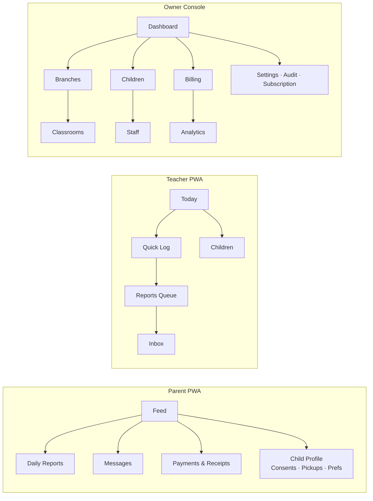

# KinderFlow — Enterprise UI/UX Design System

| Field | Value |
|-------|-------|
| Document | Enterprise Design System & UX Specification (Phase 6) |
| Version | 1.0 |
| Date | 2026-07-18 |
| Status | Pending Review — single source of truth for all UI implementation on approval |
| Inputs | BRD v1.1, SAD v1.0, RBAC v1.0 (§3 matrix, FL rules), API Contract v1.0 (DTO variants, error codes) |
| Stack constraint | Next.js + Tailwind + shadcn/ui (ADR stack); PWA-first (ADR-009); AR-RTL + EN-LTR (D7) |

---

# 01 — Design Principles

| Principle | Definition |
|-----------|-----------|
| **Calm trust** (visual philosophy) | Parents check this app while anxious; teachers use it while holding a child. Warm neutral surfaces, one confident accent, zero visual noise. Photography of children is the hero — chrome recedes |
| **Speed is the feature** (interaction) | Every core action optimized for interruption-tolerance: big targets, forgiving gestures, instant optimistic feedback, resumable flows. Teacher/gate surfaces trade density for speed; owner surfaces trade speed for density |
| **Information density by role** | Owner/Accountant: dense tables, comparison layouts (Linear/Stripe density). Teacher/Parent: one primary object per screen (Apple HIG). Receptionist: kiosk density — 3 elements max per screen |
| **Spacing** | 4-px base grid; generous by default (space-6 between sections), compact density toggle on enterprise tables only |
| **Motion** | Purposeful only: state changes, spatial continuity, AI progress. 150–250 ms standard; never decorative on safety flows; `prefers-reduced-motion` honored globally (§17) |
| **Feedback** | Every action answers in <100 ms (optimistic UI + queued badge when offline); destructive actions confirm; safety actions (pickup block) interrupt with full-screen takeover |
| **Progressive disclosure** | Default view = today + exceptions. History, filters, bulk tools behind one consistent affordance ("More" / filter bar). Wizards max 3 steps with progress indication |
| **Cognitive load** | One primary CTA per screen; secondary actions in overflow; labels always paired with icons (never icon-only for actions); numbers always with units and context (vs. last cycle) |
| **Color usage** | Semantic only: teal = primary/interactive, green = success/present, amber = pending/warning, red = danger/overdue/absent, violet = AI. Color never sole carrier of meaning (§13) |
| **Typography hierarchy** | Max 3 levels per screen; weight before size for hierarchy; financial and attendance numbers always tabular figures |
| **Cards** | Card = one domain object (child, invoice, report). No nested cards. Card actions max 2 + overflow |
| **Tables** | Enterprise surfaces only; sticky header, row hover, keyset "load more" (matches cursor pagination), column config persisted; every table has empty/loading/error states (§15–16) |
| **Forms** | Single column always; group by domain concept; inline validation on blur + submit summary (maps API `errors[]` pointers); autosave drafts on long forms (admission) |
| **Dialogs** | Confirmation ≤2 choices; forms in side sheets (desktop) / full-screen (mobile); never nest modals; destructive = red primary + typed-name confirm only for tenant-level destruction |
| **Notifications** | Toast = transient outcome (4 s, action optional); banner = persistent state (offline, sync pending, quota); inbox = history. Safety alerts bypass all preference silencing (API §2.12) |
| **AI interactions** | AI content is always **visibly provisional** until human-approved: violet accent, "Draft" chip, edit-first layout, one-tap approve after review. Never auto-advancing, never anthropomorphized ("Draft ready" not "I wrote this!") — trust rules from BRD R-09 |

---

# 02 — Design Tokens

Token format: CSS custom properties, Tailwind-mapped. Naming: `--kf-{category}-{role}-{state}`. All colors OKLCH-defined, hex fallback listed.

## 2.1 Color — Light Mode

| Token | Value | Usage |
|-------|-------|-------|
| `--kf-primary-600` | `#0D7377` (teal) | Primary actions, active nav, links |
| `--kf-primary-700` | `#0A5C5F` | Hover/pressed |
| `--kf-primary-100` | `#D7F0EF` | Selected backgrounds, badges |
| `--kf-secondary-500` | `#E8A13D` (warm amber) | Secondary accents, highlights |
| `--kf-success-600 / -100` | `#1A7F4B` / `#DCF3E6` | Present, paid, approved |
| `--kf-warning-600 / -100` | `#B45309` / `#FEF3C7` | Pending, due soon, quota warning |
| `--kf-danger-600 / -100` | `#B91C1C` / `#FEE2E2` | Overdue, absent, blocked, destructive |
| `--kf-ai-600 / -100` | `#6D28D9` / `#EDE9FE` | AI drafts, AI chips, AI progress |
| `--kf-neutral-0…950` | 12-step gray (warm-tinted: `#FDFCFB` → `#1C1917`) | Text, surfaces, borders |
| `--kf-bg-app` | `neutral-50` | App background |
| `--kf-bg-surface` | `#FFFFFF` | Cards, sheets |
| `--kf-bg-sunken` | `neutral-100` | Wells, table headers |
| `--kf-border-default / -strong` | `neutral-200` / `neutral-300` | 1 px borders |
| `--kf-text-primary / -secondary / -muted / -inverse` | `neutral-900 / -600 / -400` / white | AA-verified pairs (§13) |

## 2.2 Dark Mode

Same semantic names, remapped: `bg-app #121110`, `bg-surface #1C1A19`, `bg-raised #242220`, text inverted (neutral-100/-400), primary lifted one step for contrast (`primary-400 #2AA5A9` as interactive), status -100 tints replaced by 15%-alpha overlays, shadows replaced by surface elevation steps. Media and child photos never filtered. Dark mode is user preference + system default; per-surface: gate mode always light (outdoor glare).

## 2.3 Elevation, Radius, Shadow

| Token | Value |
|-------|-------|
| `--kf-radius-sm / md / lg / xl / full` | 6 / 10 / 14 / 20 px / pill — cards md, sheets lg, kiosk buttons xl |
| `--kf-shadow-1` | `0 1px 2px rgb(0 0 0 / .05)` — cards |
| `--kf-shadow-2` | `0 4px 12px rgb(0 0 0 / .08)` — popovers, sticky bars |
| `--kf-shadow-3` | `0 12px 32px rgb(0 0 0 / .14)` — modals, command palette |
| Elevation rule | Max 3 levels on screen; dark mode uses surface color steps, not heavier shadows |

## 2.4 Spacing, Grid, Breakpoints

| Token | Value |
|-------|-------|
| Space scale | 4-px base: `1=4, 2=8, 3=12, 4=16, 5=20, 6=24, 8=32, 10=40, 12=48, 16=64` |
| Grid | 12-col desktop (max-width 1320 px, gutter 24); 8-col tablet (gutter 16); 4-col mobile (gutter 16, margin 16) |
| Breakpoints | `sm 640` · `md 768` (tablet portrait) · `lg 1024` (tablet landscape/laptop) · `xl 1280` · `2xl 1440+` |
| Touch targets | Min 44×44 px; teacher/gate surfaces 56×56 px; row height enterprise tables 44 px (compact 36) |

## 2.5 Typography, Motion, Focus, Z-Index Tokens

| Token | Value |
|-------|-------|
| Type scale (§03) | `display 30/36 · h1 24/32 · h2 20/28 · h3 17/24 · body 15/22 · body-sm 13/20 · caption 12/16` (px/line-height); mobile display drops to 26/32 |
| Weights | 400 regular · 500 medium (labels, nav) · 600 semibold (headings, numbers) · 700 (display, KPI values only) |
| Opacity | disabled .45 · overlay-scrim .5 · skeleton-pulse .6→1 |
| Durations | `fast 120ms · base 180ms · slow 240ms · ai-pulse 1200ms` |
| Easing | `standard cubic-bezier(0.2,0,0,1)` · `decelerate (0,0,0,1)` enter · `accelerate (0.3,0,1,1)` exit |
| Focus ring | 2 px `primary-600` + 2 px offset white/surface; visible on `:focus-visible` only; danger contexts use danger-600 ring |
| Z-index | `base 0 · sticky 10 · drawer 20 · modal 30 · toast 40 · takeover(safety) 50` — safety takeover outranks everything |

## 2.6 RTL Tokens & Rules

All spacing/positioning tokens are **logical** (`inline-start/end`, `padding-inline`, `margin-inline`) — no `left/right` in any component spec. Direction-aware tokens: `--kf-dir` (rtl/ltr), chevron/back icons auto-mirror; icons that represent real-world direction (clock, media play) never mirror; numerals per §03; progress bars and steppers flow inline-start→end (mirror in RTL); charts remain LTR-time-axis with RTL labels (industry convention, tested with Arabic users — document as UX decision UXD-01).

---
# 03 — Typography System

| Topic | Standard |
|-------|----------|
| Font pairing | **IBM Plex Sans Arabic** (AR) + **IBM Plex Sans** (EN/Latin) — same superfamily: matched x-height, weights, and rhythm; excellent Arabic legibility at UI sizes; open license; variable font served self-hosted (no external font CDN — PDPL posture) |
| Fallbacks | AR: `"IBM Plex Sans Arabic", "Noto Sans Arabic", system-ui`; EN: `"IBM Plex Sans", system-ui` |
| Arabic rules | UI size floor 15 px body (Arabic needs ≥ Latin sizes); line-height +2 px vs Latin at same size (ascender/diacritic room); letter-spacing always 0 (tracking breaks Arabic); no faux-bold — real weights only; word-wrap normal, no hyphenation |
| Latin rules | Sentence case everywhere (no ALL CAPS — poor Arabic parity); tracking -0.1 px on display sizes only |
| Mixed-language | Direction isolation per field: user content wrapped in `dir="auto"` + Unicode isolates — an Arabic sentence containing "iPad" or an English name renders correctly both ways; labels follow UI language, user content follows its own direction |
| Numerals | **Western Arabic digits (0-9) everywhere** including AR locale — Egyptian financial/business convention, avoids ٠١٢ ambiguity in amounts (UXD-02, founder-confirmable); always `font-variant-numeric: tabular-nums` for money, phone, time, tables |
| Financial values | Semibold 600 tabular; currency label after amount in AR (`١٬٥٠٠ ج.م` rendered as `1,500 EGP`/`ج.م 1,500` per locale rules), thousands separator per locale; negative = red + leading −, never parentheses (not local convention) |
| Headings scale | Per §2.5 scale; h1 = page title (one per screen), h2 = section, h3 = card title |
| Captions/labels | 12–13 px medium 500, `text-secondary`; form labels always visible (no placeholder-as-label) |
| Buttons | 15 px medium 500; kiosk buttons 17 px semibold |
| Per device | Desktop base 15; tablet 15; mobile 15 body / larger targets — size consistent, spacing adapts (avoids reflow surprises for RTL) |

# 04 — Layout System

## 4.1 Surface Shells

| Surface | Shell |
|---------|-------|
| **Owner/BM/Accountant web console** (desktop-first) | Fixed sidebar (264 px, collapsible to 72 px icon rail) inline-start + topbar (56 px: breadcrumb, search ⌘K, branch switcher, notifications, avatar) + content max-width 1320 px. Tablet: sidebar → drawer. Mobile: bottom nav (4 items) + drawer for rest |
| **Teacher PWA** (tablet/mobile) | Top app bar (classroom switcher + date + sync status) + bottom nav: **Today · Children · Log(+) · Reports · Inbox**. Center Log button raised (FAB-in-bar, 64 px) |
| **Parent PWA** (mobile-first) | Top bar (child switcher if >1 child + notifications) + bottom nav: **Feed · Reports · Messages · Payments · More** |
| **Receptionist gate mode** (tablet kiosk) | No chrome: full-screen single-purpose layout, persistent status strip (branch, time, online/offline, present count), giant action zone. Exit gate mode requires PIN |
| **Super Admin console** | Same shell as owner console, platform-plane navigation, visually distinct topbar color (neutral-900) to prevent tenant/platform confusion |

## 4.2 Layout Rules

Cards on 12-col grid: KPI 3-col (desktop) / 6 (tablet) / full (mobile). Tables full-width within content. Forms: single column max 560 px, side-sheet width 480 px (desktop). Safe areas: PWA respects `env(safe-area-inset-*)`; bottom nav +inset; gate mode margins 32 px. Alignment: reading-start aligned (right in AR); numbers in tables always end-aligned; mixed tables per-column direction isolation.

# 05 — Component Library (inventory + behavior spec)

Base = shadcn/ui primitives themed by §02 tokens (mapping §19). KinderFlow composite components below; every component ships all states: default/hover/focus/active/disabled/loading/error + RTL + dark.

| Component | Spec highlights |
|-----------|-----------------|
| Button | Variants: primary/secondary/ghost/destructive/kiosk(56px)/ai(violet). Loading = spinner replaces label, width locked. Icon+label mandatory for actions |
| Input / Textarea | Visible label, helper, error (maps API `errors[]`); prefix/suffix slots (currency, phone code +20); autosave indicator variant |
| Select / Combobox | Search ≥8 options; async combobox for children/guardians (`?q=` trigram endpoints); grouped options (branch→classroom) |
| Global Search | ⌘K command palette (console): children, guardians, invoices, actions; role-filtered results (RBAC-scoped endpoints only) |
| Avatar | Child (photo, consent-aware fallback initials), staff, org logo; presence dot variant (present/absent/out) |
| Status Badge | Semantic sets pinned to domain enums: InvoiceStatus, ReportStatus, AttendanceState, IncidentSeverity, SyncStatus — one canonical color+icon+label per enum value (single source table in Figma + code) |
| Tag / Chip | Filters (dismissible), allergy chips (danger, icon, always visible on child header — BR-05) |
| Table | Sticky header, sortable (whitelisted cols), row actions overflow, bulk-select only where bulk API exists, load-more (cursor), column visibility persisted per user, density toggle |
| Charts | Recharts themed: line (trends), bar (branch comparison), donut (occupancy), sparklines in KPI cards; empty/loading skeletons; RTL label layer |
| Timeline | Parent feed + child day view: time-stamped entries, type icon, media thumbnails, AI-draft variant (violet, §12) |
| Calendar | Month/week attendance heat view; date picker (dual EG/Gregorian labels not required — Gregorian only, UXD-03) |
| Toast / Notification center | §01 rules; center groups by day, safety alerts pinned top with acknowledge action |
| Modal / Drawer / Sheet | Side sheet inline-end (mirrors RTL); full-screen sheet mobile; focus-trapped, ESC/back-gesture dismiss (unless dirty → confirm) |
| Stat Card | KPI value (tabular 700), delta chip (▲▼ + % vs period), sparkline, drill-through link; loading skeleton fixed-height |
| Child Card | Photo, name, classroom, presence dot, allergy chips, quick actions (per role) |
| Invoice Card (parent) | Number, period, total, balance, status badge, pay-info CTA (MVP: instructions + receipts) |
| Attendance Card (gate) | Giant photo, name (2 lines max), classroom, expected pickup list preview |
| Activity Card / Media Gallery | Feed entries; gallery = consent-filtered grid, lightbox, download per permission |
| Skeletons / Loading | Skeleton mirrors final layout exactly (no spinners on content areas); shimmer 1.2 s |
| Empty states | §15 catalog — illustration + one-line + primary action |
| Offline banner | Persistent amber strip: "Offline — changes will sync" + queued count; teacher/gate only |
| Conflict banner | Danger strip on affected record + review CTA (sync `pending_review`) |
| Approval banner | Violet strip on AI drafts: "Draft — review before sending" (§12) |

# 06 — Role-Based Information Architecture

Navigation renders **only** RBAC-permitted routes (matrix §3); hidden ≠ disabled — unauthorized routes never render, direct URL → 404 page (mirrors API 404 policy).

| Role | Primary nav | Secondary / quick actions | Hidden routes (never rendered) |
|------|-------------|---------------------------|-------------------------------|
| **Owner** | Dashboard · Branches · Children · Staff · Billing · Reports(Analytics) · Messages | Settings, Audit log, Subscription, Exports; ⌘K; Quick: + Child, + Staff, Run invoice cycle | Platform routes |
| **Branch Manager** | Dashboard(branch) · Classrooms · Children · Attendance · Incidents · Staff · Messages | Approvals inbox (amendments, pickups, announcements, incidents); Quick: + Incident, Approve queue | Billing config, org settings, financial analytics |
| **Teacher** | Today · Children · **Log(+)** · Reports · Inbox | Classroom switcher; Quick-log grid (FAB); offline badge | Everything financial, other classrooms, admin |
| **Receptionist** | Gate (default) · Children · Admissions · Messages | Gate mode toggle; Quick: New admission | Financial reports, invoice detail (status-only per FL-03) |
| **Accountant** | Billing dashboard · Invoices · Payments · Fee plans · Aging · Exports | Quick: Record payment, Run cycle | Attendance write, activities, messaging (read constraints per matrix) |
| **Parent** | Feed · Reports · Messages · Payments · More(child profile, consents, pickup list, receipts) | Child switcher; notification prefs | All staff/admin surfaces |
| **Super Admin** | Tenants · Health · Flags · Break-glass · Exports | Tenant search; break-glass request flow (reason + duration form) | Tenant data without active grant |



---
# 07 — Critical User Flows

Each flow lists: actor → steps → feedback → API binding → failure paths. Full screen-by-screen specs live in Figma (§20); this section is normative for sequence and behavior.

| Flow | Design |
|------|--------|
| **Admission** | Receptionist/BM · 3-step wizard (Child → Guardians → Classroom+Fee) · autosaved draft · atomic submit (`POST /children`) · validation summary maps `errors[]` pointers to steps · success → child profile + "Invite parent" prompt |
| **Check-in** | Gate mode (§11) · QR scan or name search → child card confirm (1 tap) → optimistic green flash + parent notified · `POST /attendance-events` · offline → queued badge · errors: `ATTENDANCE_SEQUENCE_CONFLICT` inline resolution ("Already checked in at 07:42 — undo?") |
| **Check-out** | Scan/search → **pickup verification screen**: photos of authorized adults (FL-06 masked ID) → receptionist confirms person (1 tap) → done · unauthorized person → **full-screen red takeover** (SEC-SAFE-001): retry / call manager — no dismiss without action |
| **Attendance correction** | Staff requests amendment (reason mandatory) → BM approval queue → approve/reject · original never edited (BR-12) · UI shows event + amendment chain |
| **Activity logging** | §08 — quick-log grid, ≤5 taps |
| **Daily report + AI review** | §12 — teacher approval gate |
| **Invoice generation** | Accountant · pre-run review (cycle, branch, count preview) → async run (`generate-cycle`, progress via job status) → draft review table (anomaly highlights: missing fee assignment, prorations) → issue-batch confirm → parents notified · failures per-item, never all-or-nothing |
| **Payment recording** | Accountant/Receptionist · guardian search → open invoices auto-allocated FIFO (editable) → amount + method → receipt preview → confirm (`Idempotency-Key`) · overpay → credit explainer · parent gets receipt instantly |
| **Messaging** | Thread list → composer · quiet hours: composer shows "Delivers at 08:00" chip (BR-18) · recall within 15 min · admin escalation flow gated by incident ref (FL-09) |
| **Incident reporting** | Teacher: type, severity, involved child(ren — separate records), description, photos, actions taken → BM review → approve → guardian notified per severity (BR-14) → acknowledgment tracked · parent view shows acknowledged state |
| **Medication** | Guardian submits authorization (dose/route/window + signature) → BM approves → teacher sees today's due list with time chips → administer = 2 taps + auto-timestamped (immutable) · out-of-window → hard block explainer (`MED_AUTH_INVALID`) |
| **Media upload** | Camera-first capture → auto-attach to activity/incident → upload queue (background, retry) → consent engine decides visibility per child (BR-19) · quota near-limit warning at 90% (BR-21) |
| **Guardian/pickup approval** | Parent adds pickup person (photo + ID) → pending badge → BM approval queue → approved → parent + list updated (SEC-SAFE-003 notify) |
| **Offline sync** | §14 — banner + queued count; auto-sync on reconnect; per-item results |
| **Conflict resolution** | Sync `PENDING_REVIEW` items → BM queue: side-by-side (device event vs server state), timestamps + device labels → accept / amend / reject with reason · audit trail |

# 08 — Teacher Experience (speed contract)

| Requirement | Design mechanism |
|-------------|------------------|
| ≤5 taps per activity | Quick-log grid from Log(+): **tap type (1) → tap child/children multi-select (2–3) → tap preset value (4) → save (5)**. Presets per type (meal: all/most/some/none; nap: start/stop timer). Batch mode: whole-classroom meal = 3 taps total |
| Check-in <10 s | Teacher fallback check-in from Today roster: tap child → tap confirm (2 taps); gate handles main flow |
| One-hand | All primary actions in bottom 60% of screen; bottom-sheet pickers; no top-corner CTAs on phone |
| Large targets | 56 px minimum; child multi-select tiles 72 px with photos |
| Tablet optimized | Two-pane Today (roster + detail); grid scales 3→5 columns |
| Offline first | Full quick-log + attendance operable offline; queued badge per entry; sync banner; conflicts never block new logging |
| Report queue | End-of-day: Reports tab shows per-child draft status chips; approve-all-after-review pattern forbidden — each report opened at least once before approve enabled (BR-13 spirit; scroll-through counts as review — UXD-04 founder-confirmable) |

# 09 — Parent Experience

| Element | Design |
|---------|--------|
| Tone | Calm, warm, photo-forward; no admin chrome; Arabic-first microcopy reviewed by native speakers (BRD §13.1.4) |
| Feed | Reverse-chron day timeline: check-in/out chips, published activities with photos, report card at day end; skeleton → content <500 ms budget (NFR) |
| Daily report | Card: summary (LocalizedText), meals/nap/mood icons, photo strip, teacher name; open = full view; share/export per permission |
| Messaging | Single thread per child with classroom teacher + separate admin thread; quiet-hours chip; read receipts |
| Payments (MVP) | Balance card (fresh read), invoice list with status badges, invoice detail (lines), receipts with download; payment instructions (bank/cash) — gateway in Phase 2 (TD-01) |
| Notifications | Check-in/out (instant), report published, invoice issued, incident (per BR-14), announcements; preferences per category — safety alerts locked on |
| Child progress | MVP: attendance history + report archive; milestones module Phase 2 (feature-flag hidden) |
| Multi-child | Child switcher in top bar; badge per child; aggregated payments view |

# 10 — Owner Dashboard

| Element | Design |
|---------|--------|
| Layout | KPI row (Occupancy, Revenue MTD, Collection rate, Outstanding, Attendance today, Parent engagement) → alerts strip → charts grid → branch comparison table |
| KPI cards | Value + delta vs prior period + sparkline + drill-through (each card links to its detail view); data from `/analytics/overview` (kpi snapshots, 60 s cache — "updated X min ago" label for trust) |
| Charts | Revenue trend (line, cycle overlay), occupancy by branch (bar), aging buckets (stacked bar 30/60/90), attendance heatmap (calendar) |
| Branch comparison | Sortable table: occupancy %, revenue, collection %, incidents, staff ratio — per-branch drill |
| Alerts strip | Rule-driven: collection < target, occupancy drop, DLQ-of-business (unacknowledged incidents, overdue > threshold); each alert links to action |
| AI insights | MVP: AI usage/cost card; Phase 2: anomaly cards (violet, explainable "why flagged") — layout slot reserved |
| Forecasts | Phase 2 slot: occupancy forecast band on trend chart (feature-flagged) |
| Export | Per-view export button → async job → notification with download (SEC-DATA-001 notice shown) |

# 11 — Receptionist Gate Mode

| Element | Design |
|---------|--------|
| Screen | Full-screen kiosk: search field (huge, auto-focus) + QR scan button (camera) + numeric PIN pad toggle; present-count chip; online/offline dot; time |
| Identify | QR (child card/parent phone) → instant; search: type-ahead ≥2 chars, photo-first results (72 px rows); PIN: family 4-digit fallback |
| Check-in confirm | Child card (giant photo, name, classroom) + medical alert chips (BR-05, must-acknowledge if present) → single confirm button (72 px) → green full-screen flash 800 ms → auto-return to search |
| Check-out verify | Pickup screen: authorized adults as photo cards → tap person → confirm → amber flash if late pickup (auto-flag) |
| Unauthorized | Red takeover (z-50): person not on list → "Not authorized" + [Call manager] [Back] — attempt logged (SEC-SAFE-001), guardian notified; no override in gate mode (BM override in console only) |
| Offline | Banner + queued count; all flows operable; sync auto; conflict → banner directs to BM |
| Ergonomics | Landscape tablet on stand; every target ≥56 px; glare-safe light theme locked; no scroll in core flow |

# 12 — AI Experience

| Element | Design |
|---------|--------|
| Draft presentation | Violet-accent card in report editor: "Draft — generated from today's 7 logged activities" + source chips (each activity referenced, tap to view) — explainability by provenance, not model talk |
| Confidence | No numeric confidence scores (false precision); instead **coverage indicator**: "Based on 7 activities · nap time missing" — missing-data chips prompt teacher to fill gaps |
| Review & approve | Edit-first layout: draft opens in editable state; approve button enabled after open (UXD-04); edits tracked (edit-distance telemetry, SAD §7); approve = publish with confirmation showing parent-visible preview |
| Regenerate | "Re-draft" (quota-aware): shows remaining daily quota; disabled at limit with explainer (`AI_QUOTA_EXCEEDED`) |
| Loading | Skeleton report + violet progress shimmer + "Drafting from logged activities…" (1200 ms pulse); batch generation happens in background pre-shift-end — teachers usually see ready drafts |
| Errors | Provider down → template fallback banner: "AI unavailable — standard template used" (SAD §7 fallback), never a dead end |
| History | Per report: draft versions list (prompt version hidden from tenants — FL-10); restore previous draft |
| Quotas | Owner: usage card (§10); teacher: unobtrusive counter only near limit |

---
# 13 — Accessibility (WCAG 2.1 AA)

| Area | Standard |
|------|----------|
| Contrast | All token text pairs ≥4.5:1 (verified table in Figma tokens page); large text/icons ≥3:1; status badges pair color+icon+label always |
| Keyboard | Full console operability: logical tab order follows visual order **in both directions** (RTL tab order = visual RTL order); skip-to-content; ⌘K palette; roving tabindex in grids; no keyboard traps; visible focus (§2.5) |
| Screen readers | Semantic landmarks; live regions: `polite` for sync/toast, `assertive` for safety takeovers; child cards labeled "name, classroom, present since 07:42"; charts get data-table alternatives; Arabic SR tested (VoiceOver/TalkBack ar-EG) |
| RTL a11y | `dir` and `lang` attributes correct per content (mixed-language isolation §03); reading order in DOM matches visual |
| Motion reduction | `prefers-reduced-motion`: all transitions → opacity-only ≤80 ms; AI shimmer → static badge; flashes (gate) → color-fill without animation |
| Color-blind | Semantic pairs tested for deuteranopia/protanopia (teal/amber/red chosen with distinct luminance); attendance heatmap has pattern overlay option |
| Touch | Targets §2.4; gesture alternatives for all swipes (buttons exist); no long-press-only actions |
| Forms | Labels programmatic; errors `aria-describedby` + summary link-to-field; required marked textually |
| Testing gate | axe-core CI on every PR (zero criticals); manual SR pass per release on 4 critical flows (check-in, log, report approve, pay-record); a11y acceptance items in Design QA (§20) |

# 14 — Responsive Strategy

| Class | Behavior |
|-------|----------|
| Desktop 1440+ | Console full grid; side sheets; hover states active |
| Laptop 1024–1439 | Sidebar collapsible default-open; KPI 3-col |
| Tablet 768–1023 | Console: drawer nav, 2-col; Teacher: two-pane; Gate: primary target (landscape locked recommended, portrait supported) |
| Mobile ≤767 | Bottom nav shells; full-screen sheets; KPI 1-col; tables → card lists (defined per table in Figma) |
| Orientation | Teacher/Parent: portrait-first, landscape supported; Gate: landscape-first |
| PWA install | Custom install prompt after 2nd session (teacher/parent); iOS Safari instructions sheet; installed = standalone display, splash from tokens, app icons per brand |
| Offline indicators | Global banner (amber) + per-item queued badges + sync success toast; console (online-assumed) shows read-only offline notice |

# 15 — Empty States (catalog)

Formula: soft illustration (consistent set, 96 px) + one-line message (ar/en) + single primary action. Never blame, never dead-end.

| Context | Message (EN reference) | Action |
|---------|------------------------|--------|
| No children (new tenant) | "Add your first child to get started" | + New admission |
| No children (teacher classroom) | "No children assigned to this classroom yet" | Contact manager (no action for teacher) |
| No invoices | "No invoices for this cycle yet" | Run invoice cycle (accountant) / — (parent: "No invoices yet") |
| No attendance today | "No check-ins yet today" | Open gate mode (receptionist) |
| No reports | "Reports will appear after today's activities are logged" | Go to quick log (teacher) / — (parent) |
| No activities | "Nothing logged yet today" | + Log activity |
| No notifications | "You're all caught up" | — |
| No media | "Photos from the day will appear here" | Capture (teacher) |
| No AI history | "No drafts yet — drafts generate after activities are logged" | — |
| No search results | "No matches for '{q}'" | Clear search |

# 16 — Error States

| Error | UX |
|-------|-----|
| Permission denied (403 in-app edge) | Inline "You don't have access to this" card — but navigation should prevent reaching it (§06); repeated = probing telemetry |
| Route not found / cross-tenant (404) | Friendly 404 + go-home; identical for unauthorized (no existence leak, mirrors API) |
| Offline | §14 banners; action-level: queued state, never a failure toast for queueable actions |
| Conflict (409 VERSION_CONFLICT) | "This record changed while you were editing" sheet: view changes / retry with mine (field-level merge only where safe: notes) |
| Sync failed (terminal) | Item-level red badge → detail: reason + retry / discard (discard requires confirm + reason for safety items) |
| Server error (5xx) | Toast + retry; persistent failure → error card with trace_id ("Share this code with support") |
| Validation (422) | Inline per-field + submit summary; server codes mapped to localized messages (§04 API) |
| Session expired | Silent refresh first; failing that: modal re-login preserving unsaved work (draft restore) |
| Quota exceeded | Explainer sheet: what limit, current plan, upgrade path (owner) or "ask owner" (others) — `SUBSCRIPTION_LIMIT_REACHED`, `STORAGE_QUOTA_EXCEEDED`, `AI_QUOTA_EXCEEDED` each with tailored copy |

# 17 — Motion System

| Interaction | Spec |
|-------------|------|
| Screen transitions | Forward = slide-in from inline-end 240 ms decelerate (mirrors RTL); back = reverse; tab switch = crossfade 120 ms |
| Sheets/modals | Sheet: translate + fade 180 ms; modal: scale .98→1 + fade 180 ms; scrim fade 150 ms |
| Hover (desktop) | 120 ms background/border; no movement |
| Press | Scale .97, 80 ms; kiosk buttons also darken |
| Expansion | Height auto-animate 180 ms standard; chevron rotate |
| Success | Check-in flash: full-screen success fill 800 ms with check icon draw 300 ms; standard success: toast slide+fade |
| Error | Field shake ±4 px 200 ms (disabled under reduced motion); takeover: instant (no animation — urgency) |
| Loading | Skeleton shimmer 1.2 s loop; progress bars determinate whenever job progress exists (invoice run) |
| AI | Violet shimmer pulse 1200 ms on generating; draft-arrival: gentle fade-up 240 ms — deliberately calm, no sparkle theatrics |
| Micro | Badge count pop 150 ms; presence dot pulse on change (once) |

---
# 18 — Dashboard Wireframes (structural reference; LTR shown, mirrors in RTL)

**Owner Dashboard (desktop)**
```
┌────────┬──────────────────────────────────────────────────────────┐
│        │ ⌘K Search   [Branch: All ▾]              🔔  👤          │
│  KF    ├──────────────────────────────────────────────────────────┤
│ ▸Dash  │ ┌Occupancy┐ ┌Revenue ┐ ┌Collect%┐ ┌Outstand┐ ┌Attend┐   │
│ Branch │ │ 87% ▲2  │ │ 412K ▲ │ │ 94% ▬  │ │ 38K ▼  │ │ 91%  │   │
│ Child  │ └sparkline┘ └────────┘ └────────┘ └────────┘ └──────┘   │
│ Staff  │ ⚠ 3 invoices >60d · 1 incident unacknowledged            │
│ Billing│ ┌──────── Revenue trend ────────┐ ┌── Occupancy/branch ─┐│
│ Reports│ │        (line chart)           │ │     (bar chart)     ││
│ Msgs   │ └───────────────────────────────┘ └─────────────────────┘│
│ ⚙      │ ┌──────────── Branch comparison table ──────────────────┐│
└────────┴──────────────────────────────────────────────────────────┘
```

**Teacher PWA — Today (mobile)**
```
┌──────────────────────────────┐
│ Sunflower Room ▾   Jul 18  ⟳ │
│ ┌──────────────────────────┐ │
│ │ Present 12/14   ● online │ │
│ └──────────────────────────┘ │
│ ┌📷┐┌📷┐┌📷┐┌📷┐  (roster    │
│ │ ✓││ ✓││ ✗││ ✓│   grid,     │
│ └──┘└──┘└──┘└──┘   tap=child)│
│  … child detail / gaps …     │
├──────────────────────────────┤
│ Today  Children (＋) Reports ✉│
└────────────── Log ───────────┘
```

**Gate Mode (tablet landscape)**
```
┌───────────────────────────────────────────────┐
│ Branch A · 07:52 · ● online · Present: 47     │
│                                               │
│   ┌─────────────────────────────┐  ┌───────┐  │
│   │  🔍  Type child name…       │  │  QR   │  │
│   └─────────────────────────────┘  │ SCAN  │  │
│                                    └───────┘  │
│   [ PIN pad ]                                 │
└───────────────────────────────────────────────┘
   → result: giant child card + [Confirm ✓ 72px]
```

**Parent PWA — Feed (mobile)**
```
┌──────────────────────────────┐
│ Omar ▾                    🔔 │
│ ── Today ─────────────────── │
│ ● Checked in 07:45           │
│ ┌──────────────────────────┐ │
│ │ 🍽 Breakfast — ate most  │ │
│ │ 📷📷📷                    │ │
│ └──────────────────────────┘ │
│ ┌──────────────────────────┐ │
│ │ 📋 Daily report ready    │ │
│ └──────────────────────────┘ │
├──────────────────────────────┤
│ Feed Reports ✉ Payments More │
└──────────────────────────────┘
```

**Super Admin (desktop)** — same console shell, dark topbar: Tenants table (status, plan, health, MRR) → tenant detail (usage, jobs, flags) → break-glass request panel (reason, duration, expiry countdown when active).

# 19 — shadcn/ui Mapping

| KF Component | shadcn base | Tailwind/theming notes | Variants | A11y notes |
|---|---|---|---|---|
| Button | `button` | Token-mapped CVA variants; kiosk = size-xl custom | primary/secondary/ghost/destructive/kiosk/ai | Loading: `aria-busy`, label preserved |
| Input/Textarea | `input`, `textarea` | Wrapper adds label/helper/error slots | default/prefixed/autosave | `aria-describedby` wiring |
| Select/Combobox | `select`, `command`+`popover` | Async combobox composes Command | grouped/async/multi | Listbox semantics, type-ahead |
| Command palette | `command` + `dialog` | ⌘K; role-filtered sources | — | Focus trap, announce results count |
| Badge/Chip | `badge` | Semantic map table → single source | status set per enum | Icon+text always |
| Table | `table` + TanStack Table | Sticky header via CSS; cursor load-more custom | dense/comfortable | Row focus, header scope, sortable `aria-sort` |
| Dialog/Sheet/Drawer | `dialog`, `sheet` | Side = inline-end (logical) | confirm/form/fullscreen-mobile | Focus trap, dirty-guard |
| Toast | `sonner` | Token theme; queue max 3 | success/error/info/queued | `aria-live=polite` |
| Tabs/Accordion | `tabs`, `accordion` | Motion §17 | — | Arrow-key nav |
| Calendar/DatePicker | `calendar`+`popover` | Attendance heat custom layer | picker/heatmap | Grid semantics |
| Avatar | `avatar` | Consent-aware fallback logic in wrapper | child/staff/org + presence | Alt = name only (no status in alt; status separate) |
| Skeleton | `skeleton` | Layout-mirroring per view | — | `aria-hidden` |
| Charts | Recharts (not shadcn) | Token colors; RTL label layer; table alternative | line/bar/donut/spark | `role=img` + summary + data table toggle |
| Stat/Child/Invoice/Attendance cards | `card` compositions | Documented composite specs §05 | per role | Heading structure inside cards |
| Offline/Conflict/Approval banners | custom (`alert` base) | Persistent, token semantic colors | amber/red/violet | `role=status` / `alert` for red |
| Form framework | `form` (RHF+zod) | zod schemas mirror API DTO validation | — | Error summary focus management |

# 20 — Deliverables, QA & Handoff

| Deliverable | Content |
|-------------|---------|
| This document | Sections 01–19: principles, tokens, typography, layout, components, IA, flows, role experiences, a11y, responsive, states, motion, wireframes, mapping |
| Figma structure | Files: `01 Foundations` (tokens, type, grid — variables synced to CSS tokens), `02 Components` (atoms→composites, all states × RTL × dark), `03 Patterns` (tables, forms, banners), `04 Surfaces` (Console / Teacher / Parent / Gate / Platform page libraries), `05 Flows` (§07 click-through prototypes), `06 Redlines` (developer specs). Pages mirror section numbers |
| Naming convention | Figma: `KF/{Category}/{Component}/{Variant}/{State}`; code: `<KfButton>`, tokens `--kf-*`; one-to-one names Figma↔code↔this doc — drift is a QA failure |
| Design QA checklist (per screen PR) | Tokens only (no raw hex/px)? · RTL mirrored + verified? · Dark mode? · All 6 states (default/hover/focus/loading/empty/error)? · Contrast pass? · Touch targets? · DTO variant respected (no fields the role can't see — FL rules)? · Error codes mapped to copy? · Reduced-motion behavior? · Skeleton mirrors layout? |
| Developer handoff notes | Tokens ship as CSS variables + Tailwind config (single source, generated); components built RTL-logical from day one (`ps-*/pe-*`, no `pl-*/pr-*`); Figma variables export = token source of truth; every composite component has a spec table in §05 + Figma redline; API binding per flow (§07) names exact endpoints; copy keys i18n-managed (`ar` reviewed by native speaker before merge — BRD §13.1.4) |
| Open UX decisions (founder) | UXD-02 Western digits in AR (recommended: yes) · UXD-03 Gregorian-only dates (recommended: yes) · UXD-04 report review-before-approve mechanics (recommended: open-required) — plus UXD-01 chart direction (recommended: LTR time axis) |

---

## Design Review

The system serves four radically different users with one token language: the console gets Stripe-class density, the teacher gets a 5-tap speed contract, the parent gets a calm photo-first feed, and the gate gets a kiosk that works in sunlight with one hand. RTL is structural (logical properties, direction isolation, mirrored motion), not a stylesheet afterthought. Every state the API can produce — offline queue, sync conflict, quota, version conflict, AI fallback — has a designed UX; every screen's data respects RBAC DTO variants by construction. AI presentation follows the trust rules: provisional styling, provenance chips, human gate.

## Readiness Score

**90 / 100** — Deductions: wireframes are structural, full visual comps land in Figma phase (−4); four UX decisions await founder confirmation (UXD-01…04) (−3); Arabic microcopy corpus not yet written/reviewed (−3).

## Approval Checklist

| Item | Owner | Status |
|------|-------|--------|
| Principles & token system (§01–02) | Founder + Design | ☐ |
| Typography incl. digits/dates decisions UXD-02/03 (§03) | Founder | ☐ |
| Role IA & navigation trees (§06) | Founder | ☐ |
| Critical flows, esp. gate & unauthorized takeover (§07, §11) | Founder | ☐ |
| Teacher 5-tap contract & UXD-04 (§08, §12) | Founder | ☐ |
| Accessibility commitments (§13) | Tech Lead | ☐ |
| shadcn mapping & handoff rules (§19–20) | Tech Lead | ☐ |

## Next Recommended Phase

**Phase 7 — Delivery Roadmap & Implementation Plan** (`docs/07_Roadmap`): sprint-level MVP plan sequencing the approved stack of documents into build order (spike TR-10 first, then module order per dependency graph), team allocation, environment setup milestones, definition-of-done per module (docs → API spec → implementation → isolation tests → design QA), and launch-gate checklist (PDPL F2, load test, restore rehearsal). Alternatively Phase 6.5 (Figma visual comps) can run in parallel with early backend work.

