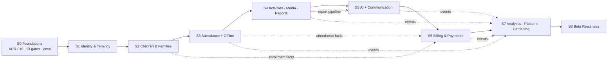

# 13 — Dependency Graph & Critical Path

| Field | Value |
|-------|-------|
| Document | Dependencies and critical path (Phase 9) |
| Version | 1.0 |
| Date | 2026-08-10 |
| Purpose | Determine safe execution order and identify what actually gates delivery |

---

## 1. Sprint-Level Dependency Graph

Solid arrows are hard sequencing. Dotted arrows are data dependencies that make the order *correct* rather than merely convenient (billing needs enrollment and attendance facts; AI needs the report pipeline; analytics projects everything).

## 2. Critical Path

```mermaid
flowchart LR
    A[KF-S0-INFRA-001<br/>git init] --> B[KF-S0-INFRA-002<br/>workspace]
    B --> C[KF-S0-OPS-002<br/>dev env]
    C --> D[KF-S0-RLS-001<br/>TR-10 SPIKE]
    D --> E[KF-S0-RLS-002<br/>ADR-010]
    E --> F[KF-S0-API-003<br/>migrations M-000/001]
    E --> G[KF-S0-RLS-003<br/>isolation harness]
    F --> H[KF-S1-TENANT-001<br/>M-002]
    G --> H
    H --> I[KF-S1-IAM-002<br/>guard pipeline]
    I --> J[KF-S2-CHILD-001<br/>M-004]
    J --> K[KF-S3-ATT-002<br/>pickup authorization]
    K --> L[KF-S3-SYNC-001<br/>batch sync]
    L --> M[KF-S4-RPT-001<br/>report state machine]
    M --> N[KF-S6-BILL-006<br/>invoice cycle]
    N --> O[KF-S8-QA-003<br/>launch gates]
```

**The critical path runs through ADR-010.** Every database-backed task in every sprint depends on it. A one-week slip in the TR-10 spike is a one-week slip in the whole programme; a *wrong* answer that is discovered in Sprint 3 is a multi-sprint rework.

Secondary critical junctions:

| Junction | Why it gates | Slip impact |
|---|---|---|
| `KF-S1-IAM-002` (guard pipeline) | Every endpoint from S1 onward declares a permission and is startup-asserted | All API work stalls |
| `KF-S2-CHILD-005` (pickup list) | Sole authorization source for the gate | S3 cannot start safely |
| `KF-S3-ATT-002` (authorization service) | Shared by online and offline paths | Both gate flows blocked |
| `KF-S4-RPT-001` (report state machine) | The structural approval gate AI depends on | S5 AI cannot ship safely |
| `KF-S6-BILL-001` (Money VO) | Every money operation | All billing blocked |

## 3. Cross-Sprint Data Dependencies

| Consumer | Producer | Nature |
|---|---|---|
| S6 fee assignments | S2 `ChildEnrolled` / `ChildWithdrawn` | Event-driven lifecycle |
| S6 proration | S3 effective-attendance query | Read model |
| S5 AI snapshot | S4 snapshot builder | Direct contract (built once in S4) |
| S5 notifications | S3/S4/S6 domain events | Outbox consumers |
| S7 projections | S2/S3/S4/S6 events | Rebuildable projections |
| S7 alerts | S5 incidents, S6 aging | Query + event |
| S8 import tooling | S2 admission, S6 fee assignment | API reuse |

## 4. Parallelization Opportunities

Within each sprint, these tracks may run concurrently once their sprint's migration task lands:

| Track | Typical tasks |
|---|---|
| **Backend domain** | Migration → aggregate → repository → use cases → endpoints |
| **Frontend** | Components → screens (can start against OpenAPI + mocks before endpoints exist — the contracts package makes this safe) |
| **QA/harness** | Isolation coverage, negative RBAC matrices, E2E scaffolds |
| **DevOps** | Environments, monitoring, backups (independent of domain work after S0) |

The contracts-first rule (`@kf/contracts` authored before implementation) is what makes frontend/backend parallelism safe — both sides code against the same approved specification, and the OpenAPI diff gate catches divergence.

## 5. Blocking Matrix — External and Decision Dependencies

| Blocked task(s) | Blocked by | Type | Owner | Needed by |
|---|---|---|---|---|
| `KF-S0-OPS-001` | GitHub org/repo | External | Founder/DevOps | S0 week 1 |
| `KF-S0-OPS-003/004` | Container registry, Coolify host | External | Founder/DevOps | S0 week 2 |
| `KF-S0-OPS-004` | **F4 hosting region decision** | Decision | Founder | S0 week 2 |
| `KF-S0-OPS-005` | S3-compatible storage account | External | Founder/DevOps | S0 week 2 |
| `KF-S0-FE-004` | **UXD-02/03 (digits, calendar)** | Decision | Founder | S0 week 2 (recommendation applies if unconfirmed) |
| `KF-S1-TENANT-006` seed values | **F1 plan price points/limits** | Decision | Founder | S1 (structure ships; numbers flagged `TODO-F1`) |
| `KF-S4-RPT-003` | **UXD-04 (review-before-approve)** | Decision | Founder | S4 (recommendation applies if unconfirmed) |
| `KF-S5-AI-001…008` | **LLM zero-retention agreement** | External/legal | Founder | Before S5 start |
| `KF-S5-NOTIF-001` | SMTP/SMS/WhatsApp provider accounts | External | Founder/DevOps | S5 |
| `KF-S8-OPS-001` | F4 decision (production region) | Decision | Founder | S8 |
| `KF-S8-QA-003` | **F2 Egypt PDPL legal review** | External/legal | Founder | Before beta — longest lead |
| Sprint calendar | Team composition confirmation | Decision | Founder | Before S1 planning |

## 6. Rule for Blocked Work

If a task's blocker is a **founder decision** with a documented recommendation (UXD-01…04, F1), implement the recommendation behind a named constant or configuration value, reference the discrepancy ID in a code comment, and record it as accepted debt. If the blocker is **external** (accounts, legal, contracts), do not simulate it — mark the task blocked, work the parallel track, and escalate. **Never invent a requirement to unblock yourself** (Phase 9 brief §22).
